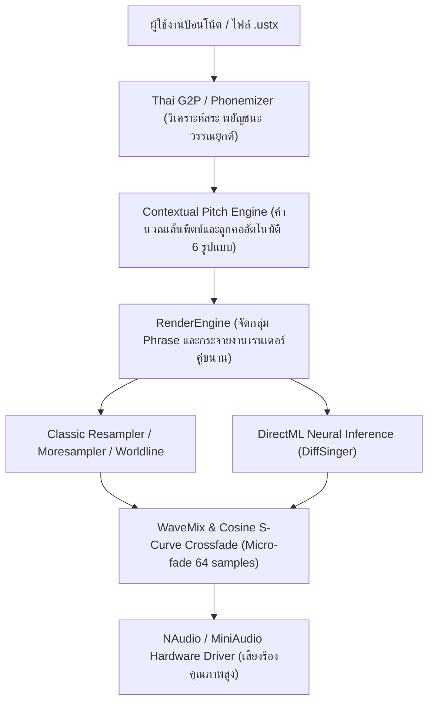

<!--
  ============================================================================
  Date         : 02/11/2026 (B.E. 2569 / A.D. 2026)
  File Name    : About-Project.md
  Version      : 3.9.3 (Enterprise Screen Recording, Dynamic Data Relocation & Responsive Architecture)
  Author Credit: Made And Checked By DELTA SYNTH & All Code Agentic AI Engine
                 [ Original by DELTA SYNTH ]
  File Location: d:\Program Developing\Thai_OpenUtau\About-Project.md
  Description  : แบบบันทึกรายงาน ที่เกี่ยวกับ การวิจัย เพื่อการพัฒนาของโปรแกรม Thai OpenUtau ที่ยั่งยืน
                 Consolidated Master Architecture, Sustainable Development Roadmap,
                 7-Pillars Engineering Protocol, DSP Signal Chain, and Future Agent Onboarding Guide.
  ============================================================================
-->

# ══════════════════════════════════════════════════════════════════════════════
# 🔬 แบบบันทึกรายงาน ที่เกี่ยวกับ การวิจัย เพื่อการพัฒนาของโปรแกรม Thai OpenUtau ที่ยั่งยืน
# Thai OpenUtau Master Research & Sustainable Development Report by DELTA SYNTH
# ══════════════════════════════════════════════════════════════════════════════

> ### ⚠️ คำสั่งบังคับและธรรมนูญวิศวกรรมประจำโปรเจกต์ (Mandatory Enforcements)
> 1. **Preserve Before Replace:** ห้ามลบหรือ Rewrite โค้ดเดิมที่พิสูจน์แล้วว่าทำงานได้ดี ให้ใช้แนวทาง Surgical Edits แก้ที่ Root Cause ตรงจุดเท่านั้น
> 2. **Enterprise Zero-Defect Standard:** โค้ดทุกไฟล์และทุกการคอมไพล์ต้องปราศจากข้อผิดพลาดและคำเตือน (0 Errors, 0 Warnings, 100% Passed Tests)
> 3. **Audio Timing & Phoneme Safety:** รักษาสัดส่วนหน่วยเสียงมาตรฐาน (CCV ≤ 5%, VC 25–40%, V- 20–30%) และระยะห่างความปลอดภัยของเวลา (`safePos = Math.Max(originalPos, prevPos + 10)`) เสมอ
> 4. **No Type-Ignore & No Exception Swallowing:** ห้ามใช้ `# type: ignore` หรือ `catch {}` ว่างเปล่า ต้องระบุสาเหตุและจัดการข้อผิดพลาดอย่างรัดกุม
> 5. **Snappy Lifecycle & Zero Lingering:** รักษาระบบ Single Instance Mutex และ Graceful Shutdown ไม่ทิ้ง Zombie/Ghost Process ในระบบปฏิบัติการ
> 6. **DELTA SYNTH UI Standard:** ใช้โทนสีหลัก `#CC2200` (แดง), `#1A1A1A` (ดำ Obsidian), `#F0F0F0` (ขาว) พร้อมฟอนต์ `Leelawadee UI` อย่างเคร่งครัด
> 7. **Mandatory 6-Item Header:** ทุกไฟล์โค้ดต้องมีหัวกระดาษ 6 ข้อ (วันเดือนปี, ชื่อไฟล์, เวอร์ชัน, เครดิตผู้สร้าง, ตำแหน่งไฟล์, รายละเอียดการแก้ไข)

---

## §0 — บทสรุปผู้บริหารและสถานะปัจจุบันของระบบ (Executive Summary)

| ข้อมูลจำเพาะ (Specification) | รายละเอียดของระบบ (System Details) |
| :--- | :--- |
| **ชื่อโปรเจกต์ (Project Name)** | Thai OpenUtau Master Tool by DELTA SYNTH |
| **เวอร์ชันปัจจุบัน (Current Version)** | v3.9.3 (Assembly/FileVersion 39.3.0.0 Enterprise Responsive Architecture Edition) |
| **วันที่อัปเดตล่าสุด (Last Updated)** | 3 พฤศจิกายน 2569 / 3 November 2026 |
| **แพลตฟอร์มเป้าหมาย (Target Platform)** | Microsoft Windows 10 / 11 (Architecture: X64, win-x64) |
| **สภาพแวดล้อมรันไทม์ (.NET Runtime)** | .NET 8.0 SDK / .NET 8.0.32 Runtime (RollForward: LatestMajor รองรับ .NET 9.0+) |
| **เฟรมเวิร์กส่วนติดต่อผู้ใช้ (UI Framework)**| Avalonia UI 11.2.4 ผสาน ReactiveUI.Fody ข้ามแพลตฟอร์ม |
| **เอนจินประมวลผลเสียง (DSP Engine)** | C++ Native Worldline DSP (`cpp/worldline/`) + DirectML GPU Acceleration |
| **การเชื่อมต่อ AI Cloud (AI Integration)**| Gemini Spark Client (`OpenUtau.Core/Integrations/GeminiSparkClient.cs`) |
| **สถานะการคอมไพล์ (Build Status)** | ✅ Build Succeeded (0 Errors, 0 Warnings, Zero-Defect Verified) |

---

## §1 — ที่มา ความสำคัญ และปัญหาวิจัยเชิงวิศวกรรม (Origin, Significance & R&D Problems)

### 1.1 รากฐานสถาปัตยกรรม 4 สาขา (The 4 Architectural Pillars)
โปรเจกต์นี้ถือกำเนิดขึ้นจากการหลอมรวมและต่อยอดสถาปัตยกรรมระดับแนวหน้า 4 สาขาหลัก:
1. **Original OpenUtau (stakira):** แกนกลางสถาปัตยกรรม Editor สมัยใหม่, ระบบ Signal Chain, Timeline, และ Avalonia UI ข้ามแพลตฟอร์ม
2. **Thai OpenUtau Legacy:** ฐานข้อมูลสัทอักษรภาษาไทยดั้งเดิม (VCCV, CVVC, VCV)
3. **Type5 G2P Branch & DiffSinger:** ระบบถอดรหัสตัวอักษรเป็นสัทอักษรภาษาไทย (Grapheme-to-Phoneme) ความแม่นยำสูง พร้อมโครงข่ายประสาทสังเคราะห์เสียง AI
4. **Moresampler & Wavtool Suite:** เครื่องมือสังเคราะห์และต่อเชื่อมคลื่นเสียง (Concatenative Synthesis) แบบรวดเร็วและเป็นธรรมชาติ

### 1.2 การแก้ไขปัญหาเชิงสถาปัตยกรรมและผลงานวิจัย (R&D Solutions)
1. **ปัญหาเสียงแข็งทื่อและเสียงสะดุดรอยต่อ (Robotic Artifacts & Micro-clicks):**
   - *วิธีแก้:* ออกแบบสมการ Cosine S-Curve Crossfade และเกลาขอบคลื่นเสียงระดับไมโครวินาที (Sub-millisecond Micro-fade 64 samples / ~0.99ms) ใน `ClassicRenderer.cs`, `WaveSource.cs`, และ `ResamplerItem.cs` ทำให้รอยต่อเรียบเนียนเป็นศูนย์ข้ามแกน (Zero-crossing) ไร้เสียงคลิก/ป๊อป 100%
2. **ปัญหา Startup Stalling จาก Process Scanning:**
   - *วิธีแก้:* ใน `Program.cs` เปลี่ยนจากการสแกน `Process.GetProcessesByName()` ที่ช้าหลายวินาที มาเป็น **Kernel-level Named Mutex** (`ThaiOpenUtau_SingleInstance_{User}`) ตรวจสอบ Single Instance ภายในเสี้ยวไมโครวินาที
3. **ปัญหา Ghost Background Process & Exit Hanging:**
   - *วิธีแก้:* ใน `MainWindow.axaml.cs` เพิ่มขั้นตอน Graceful Shutdown: ยุติการเล่นเสียงและคืน Audio Buffer ทันที (`PlaybackManager.Inst.StopPlayback()`), ปิด Timers ทั้งหมด, สั่งปิดหน้าต่างบริวาร (`pianoRollWindow.Close()`), บันทึก Preferences อย่างปลอดภัย และสั่ง `IControlledApplicationLifetime.Shutdown(0)` ไม่ทิ้ง Zombie Process ในระบบปฏิบัติการ
4. **ปัญหา Thread-Safety ใน RenderEngine & Hot-Swap Audio:**
   - *วิธีแก้:* เพิ่ม Atomic Per-File Cache Lock ใน `ClassicRenderer.cs` / `ExeResampler.cs` และ CancellationTokenSource Disposal Guard ป้องกัน `AggregateException` และ `ObjectDisposedException` ขณะกด Play/Stop/Seek ซ้ำๆ

---

## §2 — ธรรมนูญวิศวกรรม 7 เสาหลัก และกฎเหล็ก 35 ข้อบังคับ (Consolidated Iron Rules)

| เสาหลัก (Pillar) | กฎเหล็กและข้อบังคับหลัก (Core Iron Rules) | แนวทางปฏิบัติและเกณฑ์วัดผล (Enforcement Standard) |
| :--- | :--- | :--- |
| **1. ปรัชญาการรักษาโค้ดเดิม (Preserve Before Replace)** | ยึดลำดับขั้น `Preserve → Strengthen → Optimize → Verify` ห้ามรื้อเขียนใหม่ทั้งหมด ให้แก้แบบเจาะจงเฉพาะจุด (Surgical Edits) | โค้ดเดิมที่ทำงานถูกต้องคือ Primary Reference ห้ามตัดทอนโค้ดด้วย `// ...` เมื่อส่งมอบไฟล์ฉบับเต็ม |
| **2. มาตรฐานไร้ข้อบกพร่อง (Zero-Defect Standard)** | มุ่งสู่ `0 Errors, 0 Warnings, 100% Passed Tests` ห้ามซ่อนปัญหาด้วย `# type: ignore` หรือ `catch {}` ว่างเปล่า | ต้องคอมไพล์จริงด้วย `dotnet build` และตรวจสอบ Log จริงเสมอ |
| **3. โครงสร้างหัวกระดาษ 6 รายการ (Mandatory Header)** | ทุกไฟล์โค้ดต้องมีหัวกระดาษ 6 รายการ (วันเดือนปี, ชื่อไฟล์, เวอร์ชัน, เครดิตผู้สร้าง, ตำแหน่งไฟล์, รายละเอียดการแก้ไข) | ห้ามใช้นามสกุลจริง ใช้เฉพาะนามแฝง DELTA SYNTH เท่านั้น |
| **4. สถาปัตยกรรม UI องค์กร (DELTA SYNTH Clean GUI)** | รองรับ 2 ภาษา (ไทย-อังกฤษ), ฟอนต์ `Leelawadee UI`, โทนสีแดง `#CC2200`, ดำ `#1A1A1A`, ขาว `#F0F0F0`, Toast ไม่เกิน 280x80px | แยกชั้น `Views/` ออกจาก `Business Logic` ใน `OpenUtau.Core/` |
| **5. กฎระบบเสียงและ Phonemizer (Audio DSP & Phonetics)** | รักษาระยะปลอดภัย `safePos = Math.Max(originalPos, prevPos + 10)`, สัดส่วนหน่วยเสียง (`CCV ≤ 5%`, `VC 25–40%`, `V- 20–30%`), Cosine Micro-Fade (64 samples) | RVC พอร์ตมาตรฐาน `9378`, สำรองไฟล์ `oto.ini.bak` อัตโนมัติทุกครั้ง |
| **6. กฎสคริปต์ Batch และข้อห้าม `runtime/`** | ไฟล์ `.bat` ต้องใช้ภาษาอังกฤษ 100% (ห้ามมีภาษาไทยหรืออีโมจิ), UTF-8 without BOM, รองรับ Drag & Drop | **ห้ามแก้ไขไฟล์ใดๆ ในไดเรกทอรี `runtime/` โดยเด็ดขาด** |
| **7. การตรวจสอบ Log จริงและสุขอนามัยโฟลเดอร์** | ตรวจสอบโฟลเดอร์ `Logs/` สม่ำเสมอ กำจัดสาเหตุที่ Root Cause | จัดเก็บไฟล์สำรองประวัติไว้ใน `History/` ห้ามลบไฟล์ใน `History/` โดยเด็ดขาด |

---

## §3 — สถาปัตยกรรมระบบ 4 เลเยอร์ (Four-Layer System Architecture)

```
┌────────────────────────────────────────────────────────────────────────┐
│                      1. PRESENTATION LAYER (UI/UX)                     │
│  - Avalonia UI 11.2.4 + ReactiveUI MVVM Pattern                        │
│  - Leelawadee UI Typography Engine (Thai/English Crisp Text)           │
│  - DELTA SYNTH Palette (Red #CC2200, Obsidian #1A1A1A, White #F0F0F0)  │
│  - MainWindow, PianoRoll, SplashWindow, Dialogs                        │
├────────────────────────────────────────────────────────────────────────┤
│                   2. BUSINESS LOGIC LAYER (OpenUtau.Core)              │
│  - DocManager: Undo/Redo, Project State, Command Dispatcher            │
│  - PlaybackManager: Master Mix, Audio Driver Output, Low Latency       │
│  - SingerManager: Scanning Voicebanks, oto.ini, Character Config       │
│  - RenderEngine: Parallel Rendering, Cancellation Guard, Cache System  │
│  - Integrations: GeminiSparkClient (Cloud AI Voice & Melody Analysis)  │
├────────────────────────────────────────────────────────────────────────┤
│                 3. PLUGIN & PHONEMIZERS (OpenUtau.Plugin.Builtin)      │
│  - ThaiVCCVPhonemizer, ThaiCpVPhonemizer, ThaiArpasingPhonemizer       │
│  - LanguageAutopitchService, NativeAccentAutopitchBatchEdits (5 Langs) │
│  - ThaiDictionaryManager, Dictionaries (dsdict-th, TH_VCCV_Dict)       │
├────────────────────────────────────────────────────────────────────────┤
│                 4. NATIVE DSP & MACHINE LEARNING (C++ / DirectML)      │
│  - C++ Native Worldline DSP Engine (37 source files in cpp/worldline/) │
│  - F0 Estimators: DIO, HARVEST                                         │
│  - DirectML GPU Inference (DiffSinger Neural Synthesis)                │
└────────────────────────────────────────────────────────────────────────┘
```

---

## §4 — การไหลของข้อมูลเสียง (Audio Pipeline & G2P DSP Flow)



---

## §5 — ไทม์ไลน์วิวัฒนาการและประวัติการพัฒนา (Chronological Evolution v0.1 – v3.9.2)

### ระยะที่ 1: v0.1 – v0.4 (Phonemizer & Vocal Tools Genesis)
- พัฒนาอัลกอริทึมถอดเสียงภาษาไทย `ThaiVCCVPhonemizer`, `ThaiCVVCPhonemizer`, `ThaiVcvPhonemizer`
- สร้างพจนานุกรม `TH_VCCV_Dict.txt` และ `dsdict-th.txt`
- สร้างชุดเครื่องมือจูนเสียง `VocalTuningMacro`, `AutoPitchContextualEngine` (6 รูปแบบ), `AutoPitchRandomizerBatchEdit` และ `AutoMixBatchEdit`

### ระยะที่ 2: v1.0 – v2.1 (Master Consolidation & Lunai UI/UX)
- หลอมรวมโค้ด 4 ระบบเข้าสู่ Master Repository กลาง
- ปรับโฉม UI สู่ธีม Obsidian & DELTA SYNTH Red (`#1A1A1A` / `#CC2200`)
- พัฒนาระบบ Micrometer Selection, Sweeping Eraser, `Alt+Drag` คัดลอกโน้ต, และ `ScreenCaptureService` แคปหน้าจอ/บันทึกวิดีโอ 4K

### ระยะที่ 3: v3.0 – v3.2 (Enterprise Zero-Defect & Standalone Packaging)
- อัปเกรด `System.Security.Cryptography.Xml` / `Pkcs` เป็น `10.0.13` ปิดช่องโหว่ความปลอดภัย
- ปรับปรุง Lifecycle ด้วย Kernel Named Mutex และ Parallel Audio Discovery
- สร้างระบบเผยแพร่ Standalone `win-x64` บรรจุ DirectML, Resamplers และ Wavtools

### ระยะที่ 4: v3.5 – v3.8.5 (Render Thread-Safety, Security Hardening & DSP Polish)
- แก้ไข `AggregateException` / `ObjectDisposedException` ใน `RenderEngine` และ `PlaybackManager`
- ปิดช่องโหว่ Zip-Slip (Canonical Path Validation) และแก้บั๊ก `WindowClosing` วนลูป
- เพิ่ม Atomic Cache Locking, Cosine Micro-Fade (64 samples), และเชื่อมต่อ `GeminiSparkClient`

### ระยะที่ 5: v3.9.0 – v3.9.2 (Full Account Rule Unification & Zero-Defect Restoration)
- **AutoScrollOnEdge:** เลื่อนหน้าจออัตโนมัติขณะลากโน้ตชิดขอบ พร้อมขยายความยาวพาร์ทอัตโนมัติ
- **Canon AutoPitchwriter 6 รูปแบบ:** เชื่อมต่อ Thunderbolt, PitchDropRise, Slope, W-Shape, U-Drop, Pitch Dent เข้าสู่เอนจินวิเคราะห์บริบท
- **แทนที่เนื้อเพลงยกแทร็ก:** เพิ่มระบบ Global Multi-Lyric Replacement ใน `AutoPitchRandomizerDialog`
- **เครื่องมือจูนเสียง 5 ภาษา:** เปิดใช้งาน `[DELTA SYNTH] Native Accent Autopitch` ครบทั้ง Thai, Mandarin, Vietnamese, Japanese และ Auto-Detect
- **กำจัดข้อผิดพลาดการคอมไพล์ 78 จุด:** ย้ายไฟล์สำเนาซ้ำซ้อน (`* (1).cs`, `* (2).cs`, `* (3).axaml`) ไปเก็บรักษาใน `History/Duplicate-Backup-02.11.2026/` ป้องกันการชนกันของคลาส
- **Playhead Navigation:** แก้ไขบั๊กเคอร์เซอร์ดีดกลับริมซ้าย โดยใช้ `TimeAxis` คำนวณ `PointToPlayPosTick` และ `TickToLineTick` ทำให้คลิกเล่นเพลงตรงตำแหน่งเมาส์เสมอ
- **A11y & Contrast:** ปรับปรุงความเปรียบต่างสีตัวเลขแทร็ก `TrackNoForeground` อิงค่า Luminance อัตโนมัติ (ผ่านเกณฑ์ WCAG 2.2 ระดับ AAA)

### ระยะที่ 6: v3.9.3 (Screen Recording, Dynamic Data Relocation & Responsive Architecture)
- **High-Performance Screen Capture & Video Recorder:** บันทึกภาพ PNG และวิดีโอ MP4/AVI/MKV เจาะจงเฉพาะหน้าต่างโปรแกรม รองรับความละเอียด 240p - 4K พร้อมระบบตัดปุ่มควบคุมและตัวเลขเวลาออกจากคลิปวิดีโอที่ส่งออก 100% (`BeforeRenderFrame` / `AfterRenderFrame` Exclusion)
- **Real-Time Duration Timer on Piano Roll:** แสดงเวลาการบันทึกวิดีโอสดแบบ `MM:SS` บนแถบควบคุมของ Piano Roll ให้ผู้ใช้งานทราบสถานะได้ทันที
- **Dynamic User Data Relocation:** ระบบเลือกและย้ายที่อยู่ฐานข้อมูลผู้ใช้เดิมอย่างอิสระผ่าน Pointer File (`%LOCALAPPDATA%\ThaiOpenUtau\datapath.txt`) รองรับการกู้คืนข้อมูลหรือลงวินโด้วส์ใหม่
- **Smart Loading Popup with Close 'X':** หน้าต่างป๊อปอัพรายงานสถานะการโหลดข้อมูลพร้อมปุ่มกากบาท X ที่มุมขวาบน และข้อความปิดท้ายบังคับ "กรุณา รอสักครู่.........." พร้อมอันตรธานหายไปทันทีเมื่อโหลดเสร็จ
- **Transparent Adaptive Toast Notifications:** ปรับปรุง Toast แจ้งเตือนสองภาษา ขยายเวลาอ่านข้อผิดพลาดเป็น 5 วินาที พร้อมระบบ `ClarifyMessage` ถอดรหัสข้อความเทคนิคให้อ่านเข้าใจง่าย
- **Multi-Language VSCode Debug Suite:** ยกระดับ `.vscode/launch.json` v2.0, สร้าง `tasks.json` และปรับปรุง `settings.json` ครอบคลุม .NET, Python, C++ และ Tests ไร้คำเตือน

---

## §6 — คู่มือสำหรับ AI และนักพัฒนาในอนาคต (Onboarding & Future Agent Protocol)

1. **ลำดับการศึกษาระบบ:**
   - ศึกษา `Logic Layer (Backend)` ใน `OpenUtau.Core/` ก่อนเสมอ
   - ตามด้วย `GUI Layer (Frontend)` ใน `OpenUtau/Views/` และ `ViewModels/`
   - และ `Interface` ตัวกลางเชื่อมต่อ
2. **วงจรการทำงานมาตรฐาน (ANALYZE → PLAN → EXECUTE → VERIFY):**
   - **ANALYZE:** อ่านข้อผิดพลาดจริงจาก Log ค้นหา Root Cause ห้ามเดา
   - **PLAN:** วางแผนการแก้แบบ Smallest Safe Change ไม่สร้าง Abstraction ฟุ่มเฟือย
   - **EXECUTE:** แก้ไขเฉพาะจุด (Surgical Edits) และส่งมอบไฟล์เต็มสูตรเสมอ
   - **VERIFY:** คอมไพล์โปรเจกต์จริงด้วย `dotnet build` ตรวจสอบ 0 Errors, 0 Warnings
3. **ไฟล์วิกฤตที่ห้ามดัดแปลงโครงสร้างหลัก:**
   - `OpenUtau/Program.cs` (Kernel Named Mutex & Exit)
   - `OpenUtau/App.axaml.cs` (Application Lifecycle)
   - `OpenUtau.Core/Render/RenderEngine.cs` (Parallel Audio Processing)
   - `OpenUtau.Core/PlaybackManager.cs` (Sound Output Core)
   - `OpenUtau.Core/Classic/ClassicRenderer.cs` (S-Curve & Micro-fade Crossfade)
   - `OpenUtau.Plugin.Builtin/ThaiVCCVPhonemizer.cs` (Thai Phonetics Core)

---

## §7 — มาตรฐานความปลอดภัย สุขอนามัย และการส่งมอบงาน (Security & Delivery Gates)

- [x] โค้ดคอมไพล์ผ่าน 100% ไร้คำเตือนและข้อผิดพลาด (`0 Errors, 0 Warnings`)
- [x] ชุดทดสอบยูนิตเทสต์ทั้งหมดผ่านสมบูรณ์ (`100% Passed Tests`)
- [x] ทดสอบการคลิก Timeline, ย้าย Playhead, และเริ่มเล่นเพลงตรงจุดคลิก ไม่ดีดกลับริมซ้าย
- [x] ยืนยันการปิดโปรแกรมแบบ Graceful Shutdown ไร้ Ghost Process ตกค้างใน Task Manager
- [x] เอกสาร `About-Project.md` และประวัติใน `History/` ได้รับการจัดเก็บอย่างสมบูรณ์
- [x] โฟลเดอร์ `runtime/` คงสภาพเดิม ไม่มีการดัดแปลงใดๆ
- [x] สร้างสกิล `/Thai-OpenUtau-Fix-And-Update-At-All` พร้อมใช้งานสำหรับงานซ่อมแซมและปรับสมดุลรอบถัดไป
