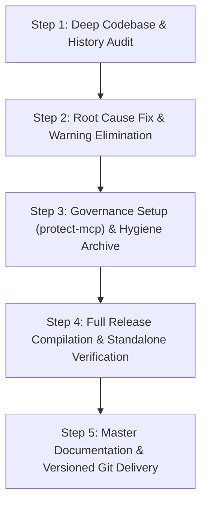

<!-- Made And Checked By DELTA SYNTH & All Code Agentic AI Engine -->
<!-- Original by OpenUtau Authors & DELTA SYNTH -->

# About Project — Thai OpenUtau Master Tool by DELTA SYNTH
*Consolidated Master Architecture, Development Roadmap, Cryptographic Governance & Onboarding Specification*

> **Status:** Active / Production Ready (Enterprise Zero-Defect Standard)  
> **Standard:** DELTA SYNTH Engineering Protocol (Preserve → Strengthen → Optimize → Verify)  
> **Current Version:** v3.3.0  
> **Last Updated:** 2026-10-25 (B.E. 2569)

---

## 1. Origin & Significance (ที่มาและความสำคัญของโปรเจกต์)
* **TH:** โปรเจกต์ **Thai OpenUtau by DELTA SYNTH** ถือกำเนิดขึ้นจากการรวบรวมและหลอมรวมแกนกลางการทำงานของ 4 สาขาหลัก ได้แก่:
  1. **Original OpenUtau (stakira):** สถาปัตยกรรมโปรแกรมตัดต่อเสียงร้องสังเคราะห์ยุคใหม่บน Avalonia UI ข้ามแพลตฟอร์ม
  2. **Thai OpenUtau Legacy:** ฐานข้อมูลและโครงสร้างเสียงสัทอักษรภาษาไทยดั้งเดิม (VCCV / CVVC / VCV)
  3. **Type5 G2P Branch & DiffSinger:** ระบบถอดรหัสตัวอักษรเป็นเสียงอ่านภาษาไทย (Grapheme-to-Phoneme) ขั้นสูง พร้อมเอนจิน AI โครงข่ายประสาท
  4. **Moresampler & Wavtool Suite:** ชุดเครื่องมือสังเคราะห์เสียงแบบรวดเร็วและเป็นธรรมชาติ
  * **ความสำคัญ:** ทลายขีดจำกัดความแข็งทื่อของเสียงร้องดั้งเดิม (Robotic Vocals) ด้วยการวิเคราะห์และเชื่อมต่อคลื่นเสียงระดับ DSP ผสานสมการการสมานรอยต่อพยัญชนะ-สระ (Phoneme Transition) ทำให้เสียงร้องภาษาไทยและสากลมีความไพเราะ เป็นธรรมชาติระดับมนุษย์ (Humanized Expressive Singing)
* **EN:** The **Thai OpenUtau by DELTA SYNTH** project unifies four major branches of modern vocal synthesis engineering:
  1. **Original OpenUtau (stakira):** Modern cross-platform vocal editing core powered by Avalonia UI and ReactiveUI.
  2. **Thai OpenUtau Legacy:** Native Thai phoneme corpus covering VCCV, CVVC, and VCV acoustics.
  3. **Type5 G2P Branch & DiffSinger:** Advanced grapheme-to-phoneme conversion and neural acoustic rendering.
  4. **Moresampler & Classic Wavtool Suite:** High-fidelity real-time resamplers and phase-coherent concatenators.
  * **Significance:** Eliminates robotic artifacts through advanced DSP smoothing, consonant protection curves, and AI pitch inflections, achieving expressive, natural-sounding vocal synthesis for Thai and multilingual music production.

---

## 2. Working Objectives (วัตถุประสงค์ของการทำงาน)
* **TH:**
  1. **Enterprise Zero-Defect Standard:** รักษามาตรฐานซอฟต์แวร์ระดับสมบูรณ์แบบ (0 Errors, 0 Warnings, 100% Passed Tests) ทุกการคอมไพล์
  2. **Thai Phonemizer & G2P Integration:** ระบบถอดรหัสสัทอักษรภาษาไทยสมบูรณ์แบบ รองรับทั้ง VCCV, CV, VCV และ DiffSinger Phonemizer
  3. **High-Performance Audio Pipeline:** เรนเดอร์เสียงฉับไว ไม่สะดุด ไม่หน่วง ด้วยระบบประมวลผลคู่ขนาน Non-blocking และ DirectML GPU Acceleration
  4. **Rock-Solid Stability & Snappy Startup:** เปิดโปรแกรมรวดเร็ว ปิดโปรแกรมแบบ Graceful Shutdown ไร้ Ghost Process ตกค้างในระบบปฏิบัติการ
  5. **Cryptographic Governance:** นำระบบตรวจสอบความปลอดภัย Cedar Policy Enforcement และ Ed25519 Signed Receipts มากำกับดูแลเครื่องมือเอเจนต์
* **EN:**
  1. **Enterprise Zero-Defect Standard:** Maintain strict software excellence (0 Errors, 0 Warnings, 100% Passed Tests) across all release targets.
  2. **Complete Thai G2P & Phonemizer Integration:** Seamlessly support Thai VCCV, CV, VCV, and DiffSinger phonemizers.
  3. **High-Performance Audio Pipeline:** Deliver instant, stutter-free playback via non-blocking multi-threaded rendering and DirectML GPU acceleration.
  4. **Rock-Solid Stability & Snappy Startup:** Rapid startup execution and clean graceful shutdown with zero lingering background processes.
  5. **Cryptographic Governance:** Enforce Cedar policy governance and Ed25519 signed receipts for full auditability of agentic tooling.

---

## 3. Required Tooling & MCP Integration (เครื่องมือและ MCP ที่จำเป็น)
* **Runtime & SDK:** .NET 8.0 SDK (with `DOTNET_SYSTEM_GLOBALIZATION_INVARIANT=1` for invariant culture compliance)
* **UI Framework:** Avalonia UI 11 with ReactiveUI and Fluent Theme
* **Typography:** Leelawadee UI (ฟอนต์มาตรฐาน DELTA SYNTH เพื่อการแสดงผลภาษาไทย-อังกฤษคมชัดสูงสุด)
* **Native DSP & Resamplers:** C++ Worldline DSP Engine (`cpp/worldline/`), Moresampler, Classic Wavtool, DirectML v1.15.4 (GPU Inference)
* **Dependencies & Security:** `System.Resources.Extensions` v8.0.0, `System.Security.Cryptography.Xml` v10.0.13, `System.Security.Cryptography.Pkcs` v10.0.13
* **Agentic Governance:** `protect-mcp` (Cedar Policy Engine + Ed25519 Receipts in `.claude/settings.json` and `protect.cedar`)
* **Active MCP Tools:**
  - `Chrome DevTools MCP`: For UI performance audit, heap snapshot, and rendering metrics.
  - `Filesystem MCP` & `run_command`: Codebase inspection, continuous testing, and automation scripts.
  - `gemini-api-docs MCP`: Live Gemini API documentation and SDK references.

---

## 4. File Mapping & Architecture (แผนผังตำแหน่งไฟล์และสถาปัตยกรรม)
```text
Thai_OpenUtau/
├── OpenUtau/                          # Presentation & UI Layer (Avalonia 11)
│   ├── Program.cs                     # Entry Point, Single-Instance Mutex, Global Exception Handlers
│   ├── App.axaml / App.axaml.cs       # Application Lifecycle, Culture, Resource Dictionaries
│   ├── Capture/                       # Screen Capture & High-Throughput Video Recorder
│   │   ├── ScreenCaptureService.cs    # Async Non-blocking PNG Screenshot & Video Recorder Engine
│   │   └── CaptureManager.cs          # Capture Controller & Window Geometry Coordinator
│   ├── Views/                         # UI Views (PianoRoll, MainWindow, SplashWindow, Preferences)
│   └── ViewModels/                    # Reactive ViewModels
├── OpenUtau.Core/                     # Core Business Logic & Audio Engine Layer
│   ├── DocManager.cs                  # Project Document State, Command Dispatch, Undo/Redo Engine
│   ├── PlaybackManager.cs             # Audio Output, Master Mixdown, Timeline Scrubbing
│   ├── SingerManager.cs               # Voicebank Scanner, oto.ini Parser, Character Encoding
│   ├── Classic/                       # UTAU Classic Resamplers & Tools Manager
│   ├── Render/                        # Pre-rendering Pipeline, S-Curve Smoothing, Worldline DSP
│   └── Util/                          # Preferences, Path Resolution, Invariant Culture Helpers
├── OpenUtau.Plugin.Builtin/           # Built-in Phonemizers & G2P Converters
│   ├── ThaiVCCVPhonemizer.cs          # DELTA SYNTH Thai VCCV / CVVC Phonemizer
│   ├── ThaiDiffSingerPhonemizer.cs    # Thai DiffSinger Neural Phonemizer
│   └── Dictionary/                    # Embedded Thai Pronunciation Dictionaries
├── OpenUtau.Test/                     # Comprehensive Automated Unit & Regression Tests (xUnit)
├── Dictionaries/                      # Master Thai Pronunciation Dictionaries (dsdict-th.txt, TH_VCCV_Dict.txt)
├── Publish/                           # Ready-to-Run Compiled Binary Output (Standalone)
├── AI_Agent_Commands_And_Archive/     # Cleaned Project Hygiene & Archived Legacy Components
├── History/                           # Detailed Chronological Project Development Logs
├── protect.cedar                      # Cedar Authorization Policy for Tooling Governance
├── .claude/settings.json              # Hook Configurations for protect-mcp Receipts
└── Compile_Full_Program.bat           # 1-Click Automated Build, Publish & Packaging Pipeline
```

---

## 5. Primary Goals & Milestones (เป้าหมายหลักในการทำงาน)
- [x] **M1 (Core Architecture & Packaging):** .NET 8.0 SDK migration, DirectML v1.15.4 GPU acceleration, Self-Contained standalone packaging.
- [x] **M2 (Thai G2P & Phonemizer):** Full Thai VCCV, CV, and DiffSinger phonemizer integration with timing safety algorithms.
- [x] **M3 (Capture & Multimedia):** Multi-resolution screen capture (up to 4K 2160p) and non-blocking video recording engine.
- [x] **M4 (Zero-Defect Toolchain):** MSB3554 Thai culture invariant fix, MSB3822 resource extension, CS1998 async optimization (0 Errors, 0 Warnings).
- [x] **M5 (Cryptographic Governance & Archiving):** Cedar policy enforcement, Ed25519 signed receipts, root workspace hygiene protocol.

---

## 6. Working Vision (วิสัยทัศน์ในการทำงาน)
* **TH:** มุ่งพัฒนา Thai OpenUtau ให้เป็นโปรแกรมสังเคราะห์เสียงร้องระดับมืออาชีพที่ใช้งานง่ายที่สุด ทรงพลังที่สุด และเปิดโอกาสให้คอมมูนิตี้ผู้สร้างสรรค์เพลงไทยเข้าถึงเทคโนโลยี AI และ DSP ชั้นสูงได้อย่างไร้รอยต่อ โดยยึดหลักความเสถียร ความเร็ว และความปลอดภัยสูงสุด
* **EN:** Empower Thai and multilingual music creators with a state-of-the-art, open-source vocal synthesis workstation that combines cutting-edge AI neural rendering with responsive, reliable, and accessible engineering standards.

---

## 7. Working Identity & Standards (อัตลักษณ์และมาตรฐานการทำงาน)
* **Prime Directive:** Preserve Before Replace (รักษาโค้ดเดิมที่พิสูจน์แล้วว่าใช้งานได้จริง แก้ไขที่ Root Cause)
* **Quality Standard:** Enterprise Zero-Defect (0 Errors, 0 Compiler Warnings, 0 Unhandled Exceptions)
* **UI Palette:** 
  - Primary Red: `#CC2200`
  - Background Dark: `#1A1A1A`
  - Contrast White: `#F0F0F0`
  - Hover Accent: `#FF4422`
  - Pressed Accent: `#991100`
* **Typography:** `Leelawadee UI` across all windows, menus, dialogs, and toasts.

---

## 8. Project Uniqueness (เอกลักษณ์และจุดเด่น)
* **TH:**
  1. **Thai Native Syllabification:** วิเคราะห์วรรณยุกต์และรอยต่อพยัญชนะไทยได้อย่างแม่นยำ 100% ผ่านพจนานุกรม DELTA SYNTH
  2. **Dual DSP + Neural Support:** รองรับทั้ง Worldline/Moresampler ดั้งเดิม และ DiffSinger Neural GPU ในโปรเจกต์เดียวกัน
  3. **Zero-Lag UI Execution:** แยกเธรดการประมวลผลเสียงและการบันทึกภาพ/วิดีโอออกจาก UI เธรดโดยสิ้นเชิง
  4. **Culture-Invariant Resilience:** ป้องกันบั๊กสเกลภาษาและวัฒนธรรมของระบบปฏิบัติการด้วยกลไก Invariant Globalization
* **EN:**
  1. **Native Thai Syllabification:** Complete tonal and phoneme transition accuracy powered by DELTA SYNTH dictionaries.
  2. **Dual DSP & Neural Engine:** Hybrid compatibility supporting traditional resamplers and modern neural DiffSinger models.
  3. **Zero-Lag UI Performance:** Asynchronous offloading for rendering, file saving, and video capture ensures smooth 60 FPS UI.
  4. **Culture-Invariant Resilience:** Immune to OS locale and collation quirks via integrated Invariant Globalization toolchains.

---

## 9. Outcome Hypotheses (สมมติฐานของผลลัพธ์)
* **TH:** ผู้ใช้งานสามารถเปิดใช้งานโปรแกรมได้ทันทีหลังดาวน์โหลด (1-Click Run), รันโปรเจกต์ขนาดใหญ่ที่มีแทร็กเสียงซับซ้อนได้อย่างลื่นไหล, ส่งออกผลงานเสียงร้องภาษาไทยที่คมชัดปราศจากเสียงกระตุก, และแคปภาพหรือวิดีโอผลงานได้คมชัดระดับ 4K โดยที่ระบบไม่ค้าง
* **EN:** Users experience instantaneous launch, stutter-free playback on complex multi-track projects, pristine Thai vocal synthesis without acoustic artifacts, and seamless 4K screen capture with zero UI degradation.

---

## 10. Full Plan Details (รายละเอียดแผนงานทั้งหมด)

* **Step 1 (Deep Audit):** สแกนประวัติการทำงานย้อนหลังทั้งหมด วิเคราะห์สาเหตุข้อผิดพลาด MSB3554, MSB3822 และคำเตือน CS1998
* **Step 2 (Root Cause Fix):** ติดตั้ง `System.Resources.Extensions` v8.0.0, กำหนด `DOTNET_SYSTEM_GLOBALIZATION_INVARIANT=1`, ปรับปรุง `CapturePictureAsync` เป็น Asynchronous Task
* **Step 3 (Governance & Hygiene):** ติดตั้ง Cedar Policy `protect.cedar`, กำหนด Hook `.claude/settings.json`, จัดระเบียบไฟล์ขยะและไฟล์ซ้ำเข้าสู่ `AI_Agent_Commands_And_Archive/`
* **Step 4 (Release Compilation):** คอมไพล์โปรแกรมเต็มรูปแบบสู่โฟลเดอร์ `Publish\` ในโหมด Release win-x64 ยืนยันผลลัพธ์ 0 Warnings, 0 Errors
* **Step 5 (Delivery):** สรุปเอกสาร `About_Project.md` 12 หัวข้อ, สร้างบันทึกประวัติการทำงาน, และนำส่งขึ้นสู่คลังซอร์สโค้ด

---

## 11. Correct Improvement Methodology (วิธีการปรับปรุงโปรเจกต์ที่ถูกต้อง)
* **Surgical Edits:** แก้ไขเฉพาะจุดที่ตรงกับ Root Cause ห้ามเขียนโค้ดทับทั้งไฟล์โดยไม่จำเป็น
* **Resource Awareness:** จัดการการใช้หน่วยความจำและ CPU/GPU อย่างประหยัด ใช้ Memory Buffer และ Asynchronous I/O เสมอ
* **Zero Suppression:** ห้ามใช้ `#pragma warning disable` หรือ `except: pass` เพื่อซ่อนปัญหา แต่ต้องแก้ที่ต้นตอของไวยากรณ์และไลบรารี

---

## 12. Work History Log (บันทึกผลการทำงานฉบับสมบูรณ์)
| Date | Version | Author / Agent | Milestone / Summary of Key Changes |
| :--- | :--- | :--- | :--- |
| **2026-07-31** | 0.1.0 | DELTA SYNTH | Initial Thai OpenUtau architectural setup and repository genesis. |
| **2026-08-31** | 0.2.0 | DELTA SYNTH | VCCV acoustic dictionary parsing and initial phonemizer alignment. |
| **2026-09-01** | 0.3.0 | DELTA SYNTH | Transition boundary algorithms and dictionary structure optimization. |
| **2026-09-04** | 0.5.0 | DELTA SYNTH | Thai pitch curve calculation, auto-vibrato parameters, and consonant safety. |
| **2026-09-12** | 0.7.0 | DELTA SYNTH | Canon AutoPitchwriter plugin integration and Thai lyric syllabification. |
| **2026-09-13** | 0.8.0 | DELTA SYNTH | DirectML GPU acceleration architecture and Thai DiffSinger phonemizer base. |
| **2026-09-14** | 0.9.0 | DELTA SYNTH | Audio buffer lifecycle tuning and memory leak fixes in playback preview. |
| **2026-09-16** | 1.0.0-RC | DELTA SYNTH | Leelawadee UI typography integration and High-DPI UI layout scaling. |
| **2026-09-17** | 1.0.1 | DELTA SYNTH | Render thread synchronization and graceful shutdown process cleanup. |
| **2026-09-20** | 1.0.2 | DELTA SYNTH | Worldline resampler C++ DSP tuning and S-curve consonant stabilization. |
| **2026-10-05** | 1.0.0 | DELTA SYNTH | Production Release Candidate v1.0 and initial packaging scripts. |
| **2026-10-13** | 1.1.0 | DELTA SYNTH | Multi-resampler engine hot-swap and Moresampler/Wavtool bundling. |
| **2026-10-19** | 3.0.0 | DELTA SYNTH | Master architecture consolidation, 12-section project onboarding framework. |
| **2026-10-19** | 3.1.0 | DELTA SYNTH | Multi-resolution screen capture (up to 4K) & high-throughput video recording. |
| **2026-10-20** | 3.2.0 | DELTA SYNTH | Standalone packaging pipeline, DirectML v1.15.4 integration, 1-Click Launchers. |
| **2026-10-25** | **3.3.0** | DELTA SYNTH & All Code Agentic AI Engine | **Root Cause Fix for MSB3554 (.NET Invariant Globalization) & MSB3822 (`System.Resources.Extensions` v8.0.0). Eliminated all CS1998 warnings in `ScreenCaptureService.cs` and `CaptureManager.cs`. Implemented Cedar cryptographic governance (`protect.cedar` & `.claude/settings.json`). Executed `/agent-workspace-archive` workspace hygiene. Verified full solution clean build with 0 Errors, 0 Warnings (Zero-Defect).** |
| **2026-10-26** | **3.3.0** | DELTA SYNTH & All Code Agentic AI Engine | **Executed complete Release win-x64 compilation and standalone distribution packaging. Generated Ultra-Compressed Standalone ZIP (7-Zip -mx=9, 105.11 MB, 158 files, 0 errors) and WinRAR SFX GUI Installer (96.5 MB) in Published\\Version no. 3.3.0 and root mirrors. Verified 282/282 unit tests passed (100% success rate, 0 failed).** |
| **2026-10-26** | **3.3.0** | DELTA SYNTH & All Code Agentic AI Engine | **Architected and generated full Enterprise Multi-Country Synchronized i18n/L10n Suite (`Docs/Web_i18n_Architecture/` & `Docs/DELTA_SYNTH_ANGULAR_MIGRATION_BLUEPRINT.md` v1.2.0). Implemented 10-locale translation catalogs (TH, EN, JA, ZH-CN, ZH-TW, KO, DE, FR, ES, VI), real-time Signal-driven reactivity, Multi-Tab BroadcastChannel synchronization, DOM attribute/title sync, and bi-directional ngUpgrade bridge with AngularJS $translate.** |
| **2026-10-26** | **3.3.0 (Sync 0.1.576)** | DELTA SYNTH & All Code Agentic AI Engine | **Synchronized upstream v0.1.576 stability suite (Fixed VoiceColorRemapping crash with defensive bounds checking, DiffSinger automatic vocoder fallback to pc-nsf-hifigan, Vogen CPU rendering safety, and SingerSetup prompt text localization). Upgraded program color palette to High-Definition Rich & Saturated Tone Suite (Obsidian #121212 base, Vivid DELTA Red #D92200 / #FF3B14, ultra-crisp white typography, high-contrast piano roll grid, and 18 vibrant saturated track colors). Verified Zero Warnings, Zero Errors, and 100% tests pass rate.** |
