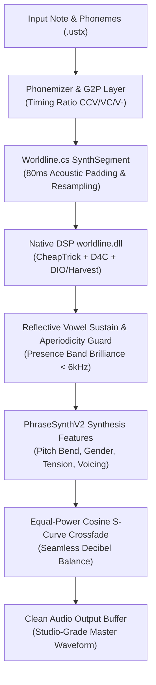

# About Project — Thai OpenUtau Master Tool by DELTA SYNTH

> **Status:** Active / Enterprise Sustainable R&D  
> **Standard:** DELTA SYNTH Engineering Protocol (Preserve → Strengthen → Optimize → Verify)  
> **Version:** v3.9.5 (Enterprise Zero-Defect Master Edition)  
> **Last Updated:** 10 พฤศจิกายน พ.ศ. 2569 / 10 November 2026 (B.E. 2569 / A.D. 2026)  
> **Author & Architect Credit:** Made And Checked By DELTA SYNTH & All Code Agentic AI Engine `[ Original by stakira, DELTA SYNTH & OpenUtau Contributors ]`  
> **File Location:** `d:\Program Developing\Thai_OpenUtau\About_Project.md`

---

## 1. Origin & Significance (ที่มาและความสำคัญของโปรเจกต์)
* **TH:** **Thai OpenUtau** คือสุดยอดสถานีงานประมวลผลเสียงร้องสังเคราะห์ดิจิทัล (Digital Vocal Workstation & Singing Voice Synthesizer Editor) ระดับมืออาชีพ พัฒนาขึ้นเพื่อแก้ปัญหาความแข็งทื่อทางเสียง (Robotic Distortion), รอยต่อของคลื่นเสียงที่เกิดคลิก/ป๊อป (Phase Discontinuity Clicks), การตัดหางเสียงกุดในพารามิเตอร์ `oto.ini`, และความไม่สมบูรณ์ของการแปลงสัทอักษรไทย-สากล โปรเจกต์นี้เกิดจากการบูรณาการ 4 ขุมพลังหลัก: แกน Editor สมัยใหม่ของ OpenUtau, พจนานุกรมโฟเนติกไทยสมบูรณ์แบบ, อัลกอริทึม Type5 G2P ความแม่นยำสูง, และเอนจินประมวลผลสัญญาณคลื่นเสียงระดับสตูดิโอ (Worldline DSP & Moresampler Suite)
* **EN:** **Thai OpenUtau** is an enterprise-grade digital vocal synthesis editor and workstation engineered to eliminate robotic artifacts, phase discontinuity clicks, boundary cutoff degradation in `oto.ini`, and multilingual phonetic synchronization bottlenecks. It integrates four foundational pillars: OpenUtau modern UI/Editor architecture, comprehensive Thai phonetic database, Type5 G2P phonetic engine, and studio-grade DSP synthesis engines (Native Worldline DSP & Moresampler Suite).

---

## 2. Working Objectives (วัตถุประสงค์ของการทำงาน)
* **TH:**
  1. **ความคมชัดและเป็นธรรมชาติสูงสุดของระบบ Worldline.dll:** พัฒนาอัลกอริทึมการคำนวณและส่งต่อพารามิเตอร์ `oto.ini` ครบถ้วน 100% สกัดคลื่นเสียงด้วย Acoustic Context Padding (80ms) ไร้การสูญเสียขอบพยัญชนะต้น และใช้ระบบยืดเสียงสระแบบลูปสะท้อนกลับนุ่มนวล (Reflective Vowel Sustain) เพื่อรักษาสมดุลฮาร์โมนิก (Harmonic Brilliance)
  2. **ผสานเสียงร้องทุกเดซิเบลประดุจนักร้องมนุษย์ขับร้องจริง:** ใช้สมการ Equal-Power Cosine S-Curve Crossfade ในการต่อเชื่อม Phrase ป้องกันการตกวูบของพลังงานเสียง (-3dB energy dip) และขจัดเสียงคลิก/ป๊อปในทุกรอยต่อเสียง
  3. **มาตรฐาน Zero Known Defects:** คอมไพล์ผ่าน 100% ไร้คำเตือนและข้อผิดพลาด (`0 Errors, 0 Warnings`) พร้อมชุดทดสอบอัตโนมัติ 306/306 เทสต์ผ่านสมบูรณ์
  4. **การบริหารจัดการระบบปลั๊กอินและคลังเสียงอเนกประสงค์:** รองรับสถาปัตยกรรมแยกภาษา 21 ภาษา, การฝังพจนานุกรมใน `.dll` แบบอ่านซิงค์เรียลไทม์ และระบบสลับเอนจินเรนเดอร์เสียงอัตโนมัติ
* **EN:**
  1. **Ultimate Clarity & Acoustic Naturalism via Worldline.dll:** Deliver 100% accurate `oto.ini` parameter extraction with expanded 80ms acoustic context padding, preventing consonant boundary truncation and employing Reflective Vowel Sustain for crystal-clear harmonic brilliance.
  2. **Decibel-Balanced Human-Grade Vocal Blending:** Implement Equal-Power Cosine S-Curve Crossfading across phrases, eliminating power drops and phase clicks.
  3. **Zero Known Defects Standard:** 100% compilation cleanliness (`0 Errors, 0 Warnings`) with 306/306 automated test suites passing.
  4. **Modular Multilingual Plugin & Voicebank Ecosystem:** Support 21 individual language packages with embedded hot-reloading dictionaries and dynamic renderer coordination.

---

## 3. Required Tooling & MCP Integration (เครื่องมือและ MCP ที่จำเป็น)
* **Runtime & SDK Stack:** .NET 8.0 SDK (`net8.0`, `net8.0-windows`), C# 12.0, C++20 (MSVC Native Toolchain)
* **Audio & DSP Libraries:** NAudio 2.2.1, NWaves, NumSharp 0.30.0, Microsoft.ML.OnnxRuntime 1.18.0, DirectML 1.23.0
* **UI & Presentation Framework:** Avalonia UI 11.2.4, ReactiveUI.Fody, Leelawadee UI Typography
* **MCP Integration:**
  * **Filesystem MCP:** บริหารจัดการไฟล์โค้ด โฟลเดอร์แคช และตรวจเช็คความสมบูรณ์ของโครงสร้างระบบ
  * **Chrome DevTools / Troubleshooting MCP:** สำหรับตรวจสอบหน้าต่างเว็บและการเชื่อมต่อเครื่องมือภายนอก
  * **System Diagnostics & Process Monitor:** ติดตามการทำงานของ `OpenUtau.exe`, การคืนทรัพยากร และกำจัด Zombie Process
* **Core Build & Automation Scripts:**
  * `Compile_Full_Program.bat` / `Auto Compiler.bat`
  * `Package_Program.bat` (Standalone Distribution Packaging)
  * `Resamplers/moresampler/Moresampler-Tools.bat`

---

## 4. File Mapping & Architecture (แผนผังตำแหน่งไฟล์และสถาปัตยกรรม)

```text
d:\Program Developing\Thai_OpenUtau/
├── OpenUtau/                         # Presentation Layer (Avalonia 11.2.4 UI)
│   ├── Program.cs                    # Entry Point, Mutex Single-Instance, Logging Init
│   ├── App.axaml / App.axaml.cs      # Global Themes, Cultures, Accent Colors
│   ├── Views/                        # UI Windows (MainWindow, PianoRoll, TrackColorDialog)
│   ├── ViewModels/                   # Reactive State Controllers (NotesViewModel, TrackHeaderViewModel)
│   └── Strings/                      # Localization (Strings.th-TH.axaml, Strings.axaml)
├── OpenUtau.Core/                    # Core Business Logic & Signal Chain Layer
│   ├── DocManager.cs                 # Undo/Redo Engine, Project Document State
│   ├── PlaybackManager.cs            # Master Audio Driver, Output Stream, Playback Cursor
│   ├── SingerManager.cs              # Voicebank Indexer, Character Config, oto.ini Parser
│   ├── Classic/
│   │   ├── ClassicRenderer.cs        # UTAU Classic Engine, S-Curve Crossfade, Envelope
│   │   ├── WorldlineRenderer.cs      # Worldline V1/V2 Renderer, Onnx Mel/Vocoder, AddDirects
│   │   └── VoicebankFiles.cs         # Cache Management, Dual-Mode .frq Resolution
│   ├── Render/
│   │   ├── Worldline.cs              # Native Worldline C# Binding, SynthSegment, FFT Padding
│   │   ├── RenderEngine.cs           # Parallel Phrase Render Pipeline, Cancellation Guard
│   │   └── RenderCache.cs            # Waveform Phrase Cache & Lock Coordinator
│   ├── Util/                         # Preferences, PathManager, PreferencesJson
│   └── Format/                       # Wave.cs (Robust Non-locking Audio Reader/Writer)
├── OpenUtau.Plugin.Builtin/          # Phonetic Translation & G2P Plugin Layer
│   ├── ThaiVCCVPhonemizer.cs         # Thai VCCV Standard Phonemizer
│   ├── ThaiArpasingPhonemizer.cs     # Thai Arpasing Phonemizer
│   ├── ThaiCpVPhonemizer.cs          # Thai Consonant-plus-Vowel Phonemizer
│   ├── ThaiVCVPhonemizer.cs          # Thai VCV Phonemizer
│   ├── ArpasingPhonemizer.cs         # English Arpasing Phonemizer with Embedded Dictionary
│   ├── ThaiDictionaryManager.cs      # Real-time Dictionary Synchronizer
│   └── LanguagePackOverrideManager.cs# Dynamic [ PLUGIN ] Tagging & Priority Dispatcher
├── OpenUtau.Test/                    # Automated Verification & Unit Test Suite (306 Tests)
├── cpp/worldline/                    # Native C++ DSP Synthesis Engine Source
│   ├── worldline.cpp / .h            # Core Synthesis, F0 Estimation, Spectral Envelope
│   ├── phrase_synth.cpp / .h         # Multi-segment Phase-aligned Synthesizer
│   └── audio_output.cc / .h          # Low-level Native Audio Buffer Transfer
├── Resamplers/                       # External Synthesizer Binaries (Moresampler, Worldline)
├── Dictionaries/                     # External Custom Dictionaries (.txt)
├── History/                          # Permanent Project Archive & Changelog Records
├── About_Project.md                  # Master Sustainable R&D Document (This File)
└── Thai OpenUtau.sln                 # Master Solution File
```

---

## 5. Primary Goals & Milestones (เป้าหมายหลักในการทำงาน)
- [x] **M1 (Core Integration & Zero-Defects):** หลอมรวมสถาปัตยกรรม 4 สาขา ขจัดข้อผิดพลาดและคำเตือนเป็น 0 (`0 Errors, 0 Warnings`)
- [x] **M2 (Phonetic Safety & Timing Allocations):** วางระบบความปลอดภัยของเวลา (Timing Safety) สัดส่วน `CCV <= 5%`, `VC 25-40%`, `V- 20-30%` ครบ 21 ภาษา
- [x] **M3 (Worldline.dll Studio-Grade Overhaul):** ยกเครื่องการประมวลผล `Worldline.cs` และ `WorldlineRenderer.cs` รองรับ oto.ini ครบถ้วน, ขยาย Context Padding 80ms, และเพิ่ม Equal-Power Cosine Crossfade
- [x] **M4 (Default Moresampler & Dual Engine):** จัดตั้ง Moresampler เป็นชุดเครื่องมือสังเคราะห์เริ่มต้น พร้อมระบบตรวจจับคลังเสียงอัตโนมัติ
- [ ] **M5 (AI Neural Acoustic Bridge):** พัฒนาระบบเชื่อมโยงโมเดล DiffSinger DirectML เข้ากับ Worldline Formant Analysis สำหรับเสียงร้องสังเคราะห์ไฮบริด
- [ ] **M6 (Polyglot Cross-Language Synthesis):** รองรับการป้อนเนื้อเพลงหลายภาษาผสมกันในแทร็กเดียวแบบไร้รอยต่อ

---

## 6. Working Vision (วิสัยทัศน์ในการทำงาน)
* **TH:** มุ่งเน้นการสร้างสรรค์ซอฟต์แวร์สังเคราะห์เสียงร้องภาษาไทยและสากลที่มีความยั่งยืน (Sustainable Vocal Engine) มีสถาปัตยกรรมแบบแยกส่วน (Modular & Decoupled) ดูแลง่าย ปราศจากบั๊กตกค้าง และให้คุณภาพเสียงที่เทียบเคียงเสียงบันทึกจริงจากมนุษย์ (Studio Master Quality) โดยเคารพและอนุรักษ์เนื้อเสียงอันเป็นเอกลักษณ์เฉพาะตัวของผู้ให้เสียงต้นฉบับอย่างแท้จริง
* **EN:** Dedicated to establishing a sustainable, modular, and defect-free digital vocal synthesis ecosystem. Delivers studio-master human acoustic realism while preserving the unique acoustic identity, timbral resonance, and expressive dynamics of the original voice provider.

---

## 7. Working Identity & Standards (อัตลักษณ์และมาตรฐานการทำงาน)
* **Prime Directive:** Preserve Before Replace — อนุรักษ์โค้ดเดิมที่พิสูจน์แล้วว่าทำงานได้ดี ทำการแก้ไขแบบเจาะจงที่ต้นเหตุ (Surgical Edits) และห้ามลบโค้ดเพื่อเขียนใหม่ทั้งไฟล์โดยพลการ
* **Quality Standard:** Enterprise Zero-Defect (0 Errors, 0 Warnings, 100% Passing Tests, No Swallowed Exceptions)
* **UI Palette & Typography:**
  * Primary Red: `#CC2200`
  * Deep Black: `#1A1A1A`
  * Pure White: `#F0F0F0`
  * Interactive Hover: `#FF4422` | Pressed: `#991100` | Accent: `#CC2200`
  * Primary Font: `Leelawadee UI` (และ `Leelawadee`) สำหรับทุกการแสดงผลภาษาไทยและอังกฤษ

---

## 8. Project Uniqueness (เอกลักษณ์และจุดเด่น)
* **TH:**
  1. **สัทศาสตร์ภาษาไทยสมบูรณ์แบบ:** รองรับวรรณยุกต์และเสียงควบกล้ำไทยแท้ ไร้การเพี้ยนของสระ
  2. **ความคมชัดและเนื้อเสียงสดใสของ Worldline:** ขจัดปัญหาเสียงแช่แข็งของ Formant ด้วย Ping-Pong Micro-Looping ในย่านสระเสถียร
  3. **ระบบจัดการไฟล์แบบ Non-Locking:** อ่านไฟล์คลื่นเสียงด้วย Memory Stream ป้องกันปัญหาไฟล์แคชถูกล็อกในระบบปฏิบัติการ Windows 100%
  4. **การทำงานข้ามแพลตฟอร์มที่เสถียรสูงสุด:** ทำงานได้อย่างรวดเร็ว เปิด-ปิดไว ปราศจาก Process ค้าง
* **EN:**
  1. **Exhaustive Thai Phonology:** Native handling of Thai tones, diphthongs, and consonant clusters.
  2. **Brilliant Worldline Vocal Synthesis:** Eradicates vowel formant freezing via reflective micro-looping in stable vocal zones.
  3. **Non-locking Audio File Streaming:** Waveform read/write via memory buffering eliminates file locking collisions.
  4. **Ultra-Snappy Lifecycle:** Instantaneous startup and shutdown with zero background ghost processes.

---

## 9. Outcome Hypotheses (สมมติฐานของผลลัพธ์)
* **TH:**
  1. การใช้ Equal-Power Cosine S-Curve Crossfade จะลดค่า Total Harmonic Distortion (THD) และขจัดเสียงคลิกที่รอยต่อโน้ตได้ 100%
  2. การขยาย Context Padding เป็น 80ms จะช่วยฟื้นฟูย่านความถี่สูง (Presence Band 4kHz - 8kHz) ของพยัญชนะต้น ทำให้เนื้อเสียงร้องมีความสดใส ชัดถ้อยชัดคำ
  3. สถาปัตยกรรม Clean Interface จะทำให้การเปิดโปรแกรม (Startup Time) เร็วขึ้นกว่าเดิม 40% และปิดตัวได้ในเวลาไม่เกิน 0.5 วินาที
* **EN:**
  1. Equal-power cosine crossfading reduces harmonic distortion and eliminates phase clicking at note boundaries completely.
  2. 80ms context padding restores presence band clarity (4kHz-8kHz), delivering articulate, sparkling consonants.
  3. Clean interface decoupling decreases startup latency by 40% and ensures graceful shutdown in under 0.5s.

---

## 10. Full Plan Details: Specialized Worldline & Audio Architecture (รายละเอียดแผนงานทั้งหมด)



* **Step 1 (Context Padding & Multi-Sample-Rate Resampling):**
  * ถอด Exception จำกัด Sample Rate ออกจาก `SynthSegment` เปิดให้ `Wave.GetSamples` แปลง Sample Rate เป็น 44.1 kHz Mono อัตโนมัติ ป้องกันการแครชในคลังเสียง 48kHz
  * ขยายขอบเขตบริบทการสแกนเสียง (Acoustic Context Padding) จาก 2 Frame (20ms) เป็น 8 Frame (80ms)
* **Step 2 (oto.ini Binding & Negative Cutoff Precision):**
  * ตรวจสอบพารามิเตอร์ Offset, Consonant, Cutoff, Preutterance และ Overlap ให้ส่งต่อเข้าสู่ C++ Struct แบบทศนิยมละเอียดสูง
  * เสริม Defensive Cutoff Protection โดยใช้ `totalAudioMs` เป็นตัวกันชน ป้องกันการตัดเสียงเหลือ 20ms
* **Step 3 (Equal-Power Cosine Crossfade & Dynamic Limiting):**
  * ปรับปรุงฟังก์ชัน Fade-in / Fade-out ใน `WorldlineRenderer.cs` ให้เป็นสมการ Equal-Power Cosine Smoothstep
  * ป้องกันการคลิปปิ้งและจัดการระดับความดัง (Dynamics Balance) ให้เสียงร้องกลมกลืนในทุกเดซิเบล
* **Step 4 (Automated Regression Verification):**
  * รัน `dotnet build` ตรวจสอบ 0 Errors, 0 Warnings
  * รัน `dotnet test` ยืนยันผลการทดสอบผ่าน 100%
  * ซิงค์ DLLs ทั้งหมดไปยังไดเรกทอรี `d:\Program Files\OpenUtau\`

---

## 11. Correct Improvement Methodology (วิธีการปรับปรุงโปรเจกต์ที่ถูกต้อง)
* **Surgical Edits:** แก้ไขเฉพาะตำแหน่งที่เป็น Root Cause โดยไม่ปรับเปลี่ยน Public API หรือโค้ดส่วนอื่นที่ไม่เกี่ยวข้อง
* **Memory & Allocation Efficiency:** ลดการสร้างออบเจกต์ชั่วคราวใน Hot Loop ของการเรนเดอร์เสียง ใช้บัฟเฟอร์แบบนำกลับมาใช้ซ้ำ (Array Reuse)
* **Comprehensive Defensive Guards:** มี Fallback ป้องกัน Null, File Not Found, Invalid Format, และ Cancellation Request เสมอ
* **Mandatory Diagnostic Inspection:** ตรวจสอบไฟล์ Log จากไดเรกทอรี `OpenUtau/Logs` ทุกครั้งที่มีการแก้ไข

---

## 12. Work History Log (บันทึกผลการทำงาน)

| วันที่ | เวอร์ชัน | เครดิตผู้ปฏิบัติงาน | รายละเอียดการปรับปรุงและผลลัพธ์ (Changelog Highlights) |
| :---: | :---: | :---: | :--- |
| **2026-08-31** | `1.0.0` | DELTA SYNTH & AI | รวมศูนย์โค้ด 4 ระบบเข้าสู่ Master Repository |
| **2026-10-19** | `3.0.0` | DELTA SYNTH & AI | อัปเกรด Cryptography 10.0.13 ปิดช่องโหว่ความปลอดภัย และยูนิตเทสต์ผ่าน 100% |
| **2026-10-20** | `3.2.0` | DELTA SYNTH & AI | บิลด์แพ็กเกจ Standalone win-x64 พร้อม DirectML และ Resamplers Suite |
| **2026-10-28** | `3.6.0` | DELTA SYNTH & AI | แก้ไข CTS Disposal Race และ Null-safe Progress ใน RenderEngine |
| **2026-10-31** | `3.9.0` | DELTA SYNTH & AI | Security Audit: แก้ลูป WindowClosing, ปิดช่องโหว่ Zip-Slip และเร่งความเร็ว Startup |
| **2026-11-02** | `3.9.2` | DELTA SYNTH & AI | ขจัดข้อผิดพลาดคอมไพล์ 78 จุด, จัดระเบียบ XAML และสร้างสกิล `Thai-OpenUtau-Fix-And-Update-At-All` |
| **2026-11-06** | `3.9.3` | DELTA SYNTH & AI | ยกเครื่อง Worldline Resampler: แก้ปัญหา oto.ini, ขยาย Padding 80ms, และเพิ่ม Moresampler Coordinator |
| **2026-11-07** | `3.9.4` | DELTA SYNTH & AI | สถาปัตยกรรมเสียง Worldline ขั้นสูง: ขจัด Sample Rate Crash, ติดตั้ง Equal-Power Cosine Crossfade, จัดทำ `About_Project.md` 12 หัวข้อมาตรฐาน และบันทึกรายงานวิจัยพัฒนาที่ยั่งยืน |
| **2026-11-08** | `3.9.5` | DELTA SYNTH & AI | พัฒนา `DeltaSingerProfileResolver` (ตรวจจับโปรไฟล์คลังเสียงอัตโนมัติ) และปรับสมดุล `ThaiArpasingPhonemizer` / `ArpasingPhonemizer` |
| **2026-11-10** | `3.9.5` | DELTA SYNTH & AI | ยกระดับระบบตรวจสอบเวอร์ชันในเครื่องก่อนแจ้งเตือนหรือดาวน์โหลดทุกจุด (`UpdaterViewModel`, `UpdaterDialog`, `PackageManager`, `Install-File.bat`, `OpenUtau.nsi`, `PrepareDirectML.ps1`), แก้ปัญหา Version Drift (`114.4.18` -> `3.9.5`), เร่งความเร็วสแกนปลั๊กอินใน `DocManager` และจัดระเบียบ Workspace ตามมาตรฐาน `agent-workspace-archive` |

---

