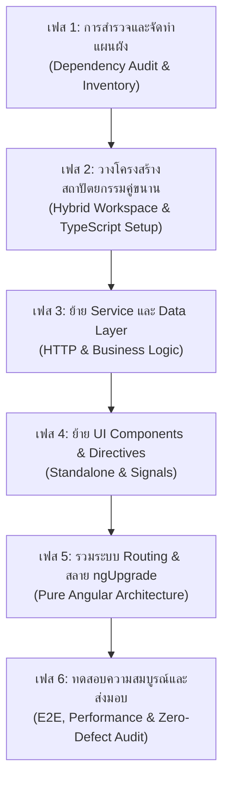

<!-- ======================================================================== -->
<!-- Date: 26/10/2569 (BE) / 26/10/2026 (CE)                               -->
<!-- File: DELTA_SYNTH_ANGULAR_MIGRATION_BLUEPRINT.md                       -->
<!-- Version: 1.0.0                                                         -->
<!-- Made And Checked By DELTA SYNTH & All Code Agentic AI Engine           -->
<!-- [ Original by DELTA SYNTH ]                                            -->
<!-- Location: Docs/DELTA_SYNTH_ANGULAR_MIGRATION_BLUEPRINT.md               -->
<!-- Description: Master Architectural Blueprint for migrating legacy       -->
<!--              AngularJS (1.x) systems to Modern Angular 18+             -->
<!--              (Standalone Components, Signals, ngUpgrade, DELTA UI)    -->
<!-- ======================================================================== -->

# พิมพ์เขียวสถาปัตยกรรมระดับองค์กร: การย้ายระบบ AngularJS สู่ Modern Angular (18+)
## DELTA SYNTH Enterprise Angular Migration Blueprint & Operational Architecture

> **สถานะเอกสาร:** มาตรฐานหลักระดับองค์กร (DELTA SYNTH Master Engineering Blueprint)  
> **หลักการสำคัญ:** **Preserve → Strengthen → Optimize → Verify**  
> **เป้าหมาย:** สถาปัตยกรรมระบบเว็บยุคใหม่ที่มีเสถียรภาพสูงสุด รวดเร็ว ไร้การหน่วง (Zero Lag) ตอบสนองฉับไวดั่งสายฟ้า และมุ่งสู่ **Zero Known Defects**

---

## 1. บทนำและหลักการพื้นฐาน (Executive Summary & Core Directives)

* **TH:** การเปลี่ยนผ่านระบบเว็บแอปพลิเคชันจากยุคดั้งเดิม **AngularJS (1.x)** สู่ยุคใหม่ **Modern Angular (18+)** ไม่ใช่การเขียนโค้ดใหม่ทั้งหมดโดยไม่ไตร่ตรอง (Blind Rewrite) แต่เป็นการปฏิรูปโครงสร้างสถาปัตยกรรม (Architectural Evolution) อย่างเป็นขั้นเป็นตอน ภายใต้กฎเหล็กของ DELTA SYNTH:
  - **Preserve Before Replace:** รักษากลไกและ Business Logic เดิมที่ผ่านการพิสูจน์แล้วว่าทำงานได้ถูกต้อง
  - **Zero Known Defects:** คอมไพล์ผ่าน 100% ไร้ข้อผิดพลาด และไร้คำเตือนตกค้าง (0 Errors, 0 Warnings)
  - **Resource-Aware Optimization:** ประหยัด CPU, RAM, Network Throughput และลดภาระการประมวลผลบนเบราว์เซอร์
* **EN:** Migrating from legacy **AngularJS (1.x)** to **Modern Angular (18+)** is an enterprise-grade architectural transformation. Following DELTA SYNTH standards, we preserve proven business logic, avoid disruption to active users via hybrid interoperability, eliminate obsolete digest cycles, and transition to fine-grained signal-based reactivity and standalone components.

```mermaid
graph LR
    subgraph Legacy ["AngularJS 1.x (Legacy Layer)"]
        A1["$scope & Controllers"]
        A2["Directives & JQLite"]
        A3["$http & $q Services"]
        A4["$routeProvider / UI-Router"]
    end

    subgraph Bridge ["DELTA SYNTH ngUpgrade Bridge"]
        B1["UpgradeModule Interop"]
        B2["downgradeInjectable / upgradeComponent"]
        B3["Unified Event Bus & State Bridge"]
    end

    subgraph Modern ["Modern Angular 18+ (Target Layer)"]
        C1["Standalone Components & Signals"]
        C2["Control Flow (@if, @for, @switch)"]
        C3["HttpClient, RxJS & Signal Store"]
        C4["Functional Router & Lazy Load"]
    end

    Legacy --> Bridge
    Bridge --> Modern
```



---

## 2. ตารางเปรียบเทียบและการเลือกกลยุทธ์ (Migration Strategy Matrix)

การเลือกแนวทางการย้ายระบบขึ้นอยู่กับขนาดโปรเจกต์ ความถี่ในการส่งมอบงาน และความเสี่ยงทางธุรกิจ:

| กลยุทธ์ (Strategy) | รูปแบบการดำเนินงาน (Execution Model) | ข้อดี (Pros) | ข้อควรระวัง (Cons) | ความเหมาะสมตามมาตรฐาน DELTA SYNTH |
| :--- | :--- | :--- | :--- | :--- |
| **1. Incremental Hybrid (ngUpgrade)** | รัน AngularJS และ Angular ควบคู่กัน ย้ายทีละคอมโพเนนต์/เซอร์วิส | ไม่ขัดจังหวะการใช้งานจริง ส่งมอบฟีเจอร์ใหม่ได้ต่อเนื่อง | มี Bundle Size ชั่วคราวเพิ่มขึ้นจากการโหลด 2 รันไทม์ | **แนะนำสูงสุด (Recommended)** สำหรับโปรเจกต์ขนาดกลาง-ใหญ่ |
| **2. Vertical Slice** | ย้ายทั้งหน้าหรือโมดูลย่อยให้เสร็จสิ้นเป็นชิ้นๆ จากหน้าบ้านถึงหลังบ้าน | ขอบเขตการทดสอบชัดเจน ตัดขาดระบบเก่าได้เร็วเป็นจุดๆ | ต้องมี Routing Bridge ระหว่างหน้า | เหมาะสำหรับระบบที่มีโมดูลแยกขาดจากกันชัดเจน |
| **3. Complete Rewrite (Big Bang)** | เขียนระบบใหม่ทั้งหมดตั้งแต่ต้นและสลับใช้งานพร้อมกัน | โครงสร้างสะอาด ไม่ต้องแบกรับเทคโนโลยีลูกผสม | ความเสี่ยงสูง ใช้เวลานาน และอาจเกิดข้อผิดพลาดถดถอย | อนุญาตเฉพาะโปรเจกต์ขนาดเล็กมาก (SPA หน้าเดียว) |

---

## 3. สถาปัตยกรรมระบบลูกผสม (Hybrid ngUpgrade Architecture)

สำหรับระบบที่ต้องการความต่อเนื่องทางธุรกิจ ให้ติดตั้งโมดูลลูกผสมเพื่อเชื่อมต่อ Context ระหว่าง 2 รันไทม์:

### 3.1 การบูตสแตรประบบสองชั้น (Dual-Bootstrapping Architecture)
```typescript
// src/main.ts - การบูตสแตรประบบลูกผสมระดับองค์กร
import { platformBrowserDynamic } from "@angular/platform-browser-dynamic";
import { UpgradeModule } from "@angular/upgrade/static";
import { AppModule } from "./app/app.module";

platformBrowserDynamic()
  .bootstrapModule(AppModule)
  .then((platformRef) => {
    const upgrade = platformRef.injector.get(UpgradeModule);
    // เชื่อมต่อรันไทม์เข้ากับแอปพลิเคชัน AngularJS เดิมอย่างปลอดภัย
    upgrade.bootstrap(document.documentElement, ["legacyDeltaApp"], { strictDi: true });
    console.log("[DELTA SYNTH] Hybrid ngUpgrade Bridge initialized successfully.");
  })
  .catch((err) => console.error("[DELTA SYNTH] Hybrid bootstrap failure:", err));
```

### 3.2 การกำหนดค่า Root Module สำหรับระบบลูกผสม
```typescript
// src/app/app.module.ts
import { NgModule, DoBootstrap } from "@angular/core";
import { BrowserModule } from "@angular/platform-browser";
import { HttpClientModule } from "@angular/common/http";
import { UpgradeModule } from "@angular/upgrade/static";

@NgModule({
  imports: [
    BrowserModule,
    HttpClientModule,
    UpgradeModule
  ],
  providers: [
    // กำหนด Service Providers หลัก
  ]
})
export class AppModule implements DoBootstrap {
  constructor(private upgrade: UpgradeModule) {}

  ngDoBootstrap() {
    // การบูตสแตรปจะถูกควบคุมโดย UpgradeModule ใน main.ts
  }
}
```

---

## 4. วิวัฒนาการของคอมโพเนนต์ (Component Evolution & Signal Patterns)

### 4.1 การแปลงจาก AngularJS Controller/Scope สู่ Angular Standalone Component

#### โค้ดเดิม (AngularJS 1.x Legacy):
```javascript
// legacy/controllers/user-profile.controller.js
angular.module("legacyDeltaApp")
  .controller("UserProfileController", function ($scope, $http, NotificationService) {
    $scope.user = null;
    $scope.isLoading = false;

    $scope.loadProfile = function (userId) {
      $scope.isLoading = true;
      $http.get("/api/v1/users/" + userId)
        .then(function (response) {
          $scope.user = response.data;
        })
        .catch(function (error) {
          NotificationService.showError("Failed to fetch profile");
        })
        .finally(function () {
          $scope.isLoading = false;
        });
    };
  });
```

#### โค้ดใหม่ตามมาตรฐาน Modern Angular 18+ (DELTA SYNTH Pattern):
```typescript
// src/app/features/user/user-profile.component.ts
import { Component, ChangeDetectionStrategy, signal, computed, inject, OnInit } from "@angular/core";
import { CommonModule } from "@angular/common";
import { HttpClient } from "@angular/common/http";
import { finalize } from "rxjs/operators";

export interface UserProfile {
  id: string;
  name: string;
  role: string;
  avatarUrl: string;
}

@Component({
  selector: "delta-user-profile",
  standalone: true,
  imports: [CommonModule],
  changeDetection: ChangeDetectionStrategy.OnPush, // บังคับ OnPush เพื่อประสิทธิภาพสูงสุด
  template: `
    <section class="delta-card">
      @if (isLoading()) {
        <div class="delta-spinner">กำลังโหลดข้อมูล...</div>
      } @else if (user(); as profile) {
        <div class="delta-profile-header">
          
          <div class="delta-info">
            <h2 class="delta-title">{{ profile.name }}</h2>
            <span class="delta-badge">{{ userRoleBadge() }}</span>
          </div>
        </div>
      } @else {
        <p class="delta-empty">ไม่พบข้อมูลผู้ใช้งาน</p>
      }
    </section>
  `,
  styleUrls: ["./user-profile.component.scss"]
})
export class UserProfileComponent implements OnInit {
  private readonly http = inject(HttpClient);

  // สัญญาณปฏิกิริยา (Fine-Grained Signals) แทนที่ $scope dirty checking
  readonly user = signal<UserProfile | null>(null);
  readonly isLoading = signal<boolean>(false);

  // คำนวณค่าอัตโนมัติ (Computed State) ปราศจาก side effects
  readonly userRoleBadge = computed(() => {
    const current = this.user();
    return current ? `[DELTA SYNTH] ${current.role.toUpperCase()}` : "";
  });

  ngOnInit(): void {
    this.loadProfile("usr_9378");
  }

  loadProfile(userId: string): void {
    this.isLoading.set(true);
    this.http.get<UserProfile>(`/api/v1/users/${userId}`)
      .pipe(finalize(() => this.isLoading.set(false)))
      .subscribe({
        next: (data) => this.user.set(data),
        error: (err) => console.error("[DELTA SYNTH] Profile load error:", err)
      });
  }
}
```

---

## 5. การส่งต่อข้อมูลและการฉีด Dependency ข้ามระบบ (Dependency Injection Bridging)

### 5.1 การดาวน์เกรด Angular Service ไปให้ AngularJS เรียกใช้งาน (Downgrading)
เมื่อพัฒนา Service ใหม่ใน Angular 18 และต้องการให้ Controller ของ AngularJS เดิมเรียกใช้งานได้:

```typescript
// src/app/core/services/audio-processor.service.ts
import { Injectable } from "@angular/core";
import { downgradeInjectable } from "@angular/upgrade/static";

declare const angular: any;

@Injectable({
  providedIn: "root"
})
export class AudioProcessorService {
  processWaveform(sampleRate: number): string {
    return `[DELTA DSP] Rendered at ${sampleRate} Hz via WebAudio API`;
  }
}

// จดทะเบียนส่งต่อ Service ไปยังระบบ AngularJS เดิม
angular.module("legacyDeltaApp")
  .factory("audioProcessorService", downgradeInjectable(AudioProcessorService));
```

### 5.2 การอัปเกรด AngularJS Service ให้ Angular เรียกใช้งาน (Upgrading)
เมื่อ Angular ต้องการเรียกใช้ Utility หรือ Config เดิมของ AngularJS ที่ยังไม่ได้ย้าย:

```typescript
// src/app/core/tokens/legacy-services.token.ts
import { InjectionToken } from "@angular/core";

export const LEGACY_AUTH_SERVICE = new InjectionToken<any>("LegacyAuthService");

export const LegacyAuthServiceProvider = {
  provide: LEGACY_AUTH_SERVICE,
  useFactory: (injector: any) => injector.get("AuthService"),
  deps: ["$injector"]
};
```

---

## 6. การย้ายระบบ Routing และสถาปัตยกรรม Lazy Loading

แทนที่ `$routeProvider` หรือ `ui-router` ดั้งเดิมด้วย Modern Standalone Router พร้อมฟังก์ชัน Route Guards:

```typescript
// src/app/app.routes.ts
import { Routes } from "@angular/router";
import { inject } from "@angular/core";
import { AuthService } from "./core/services/auth.service";

export const APP_ROUTES: Routes = [
  {
    path: "",
    redirectTo: "dashboard",
    pathMatch: "full"
  },
  {
    path: "dashboard",
    loadComponent: () => import("./features/dashboard/dashboard.component").then(m => m.DashboardComponent)
  },
  {
    path: "audio-studio",
    canActivate: [() => inject(AuthService).isAuthenticated()],
    loadChildren: () => import("./features/studio/studio.routes").then(m => m.STUDIO_ROUTES)
  },
  {
    path: "**",
    loadComponent: () => import("./core/views/not-found.component").then(m => m.NotFoundComponent)
  }
];
```

---

## 7. มาตรฐานการออกแบบ UI ตามระเบียบ DELTA SYNTH (UI Standards)

ทุกคอมโพเนนต์ที่ย้ายมาสู่ Angular ต้องรองรับโทนสีและ Typography ของ DELTA SYNTH อย่างเคร่งครัด:

```scss
// src/styles/_delta-variables.scss
$font-family-base: "Leelawadee UI", "Leelawadee", -apple-system, BlinkMacSystemFont, "Segoe UI", Roboto, sans-serif;

// โทนสีมาตรฐานองค์กร DELTA SYNTH
$delta-red-primary: #CC2200;
$delta-black-bg:    #1A1A1A;
$delta-white-text:  #F0F0F0;
$delta-hover:       #FF4422;
$delta-pressed:     #991100;
$delta-highlight:   #CC2200;

// มาตรฐาน Toast Notification
.delta-toast {
  max-width: 280px;
  max-height: 80px;
  position: fixed;
  bottom: 20px;
  right: 16px;
  border-radius: 6px;
  background-color: $delta-black-bg;
  color: $delta-white-text;
  border-left: 4px solid $delta-red-primary;
  box-shadow: 0 4px 12px rgba(0, 0, 0, 0.4);
  font-family: $font-family-base;
  padding: 10px 14px;
}
```

---

## 8. ขั้นตอนการปฏิบัติงาน 6 เฟส (Stepwise Operational Roadmap)



1. **เฟส 1 (Discovery & Audit):** ตรวจนับ Controllers, Directives, Filters และ Services ประเมินความเสี่ยงและจัดกลุ่มตาม Feature Boundaries
2. **เฟส 2 (Workspace Preparation):** ติดตั้ง Angular CLI เวอร์ชันล่าสุด ตั้งค่า TypeScript Strict Mode และเชื่อมต่อ `UpgradeModule`
3. **เฟส 3 (Service Migration):** แปลง `$http` และ `$q` เป็น `HttpClient` และ `RxJS` พร้อมทำการดาวน์เกรดให้ AngularJS เรียกใช้ได้
4. **เฟส 4 (Component Migration):** ทยอยแปลง Directives และ Templates เป็น Standalone Components พร้อมใช้ Signals แทน `$scope.$watch`
5. **เฟส 5 (De-hybridization):** ปลดระวาง AngularJS รันไทม์ และสคริปต์เก่าออกทั้งหมด เปลี่ยนระบบ Routing สู่ Angular Router แท้
6. **เฟส 6 (Verification & Optimization):** ตรวจสอบ Core Web Vitals, วัด Bundle Size, ทดสอบ Unit Tests (100% Pass) และตรวจสอบ Zero Warnings

---

## 9. ข้อบังคับและข้อห้าม (Strict Directives & Forbidden Practices)

* **ห้ามใช้ `$scope.$apply()` หรือ `$scope.$digest()` ซ้ำซ้อน:** ให้เปลี่ยนไปใช้ Signals หรือ OnPush Change Detection
* **ห้ามปล่อยให้มี Any Type ตกค้าง:** Public API และ Data Contracts ต้องมี TypeScript Interfaces ชัดเจน
* **ห้ามตัดตอนการทำงานขณะมีสถานะก้ำกึ่ง:** ทุกขั้นตอนของการย้ายระบบลูกผสม แอปพลิเคชันต้องสามารถรันและทดสอบผ่านได้ตลอดเวลา (Continuous Shippable State)
* **รักษาความเข้ากันได้ของ API Endpoint:** Data Contracts ที่ส่งไปยัง Backend ต้องรักษาโครงสร้างเดิม เว้นแต่จะได้รับคำสั่งปรับปรุงเป็นลายลักษณ์อักษร

---

## 10. เอกสารอ้างอิงและการเชื่อมโยง (References & Ecosystem Alignment)
- [Official Angular Update Guide](https://angular.dev/update-guide)
- [ngUpgrade Comprehensive Documentation](https://angular.dev/tools/cli/upgrade)
- [`Docs/About_Project.md`](file:///d:/Program%20Developing/Thai_OpenUtau/About_Project.md)
- [`Docs/AGENT.md`](file:///d:/Program%20Developing/Thai_OpenUtau/Docs/AGENT.md)
