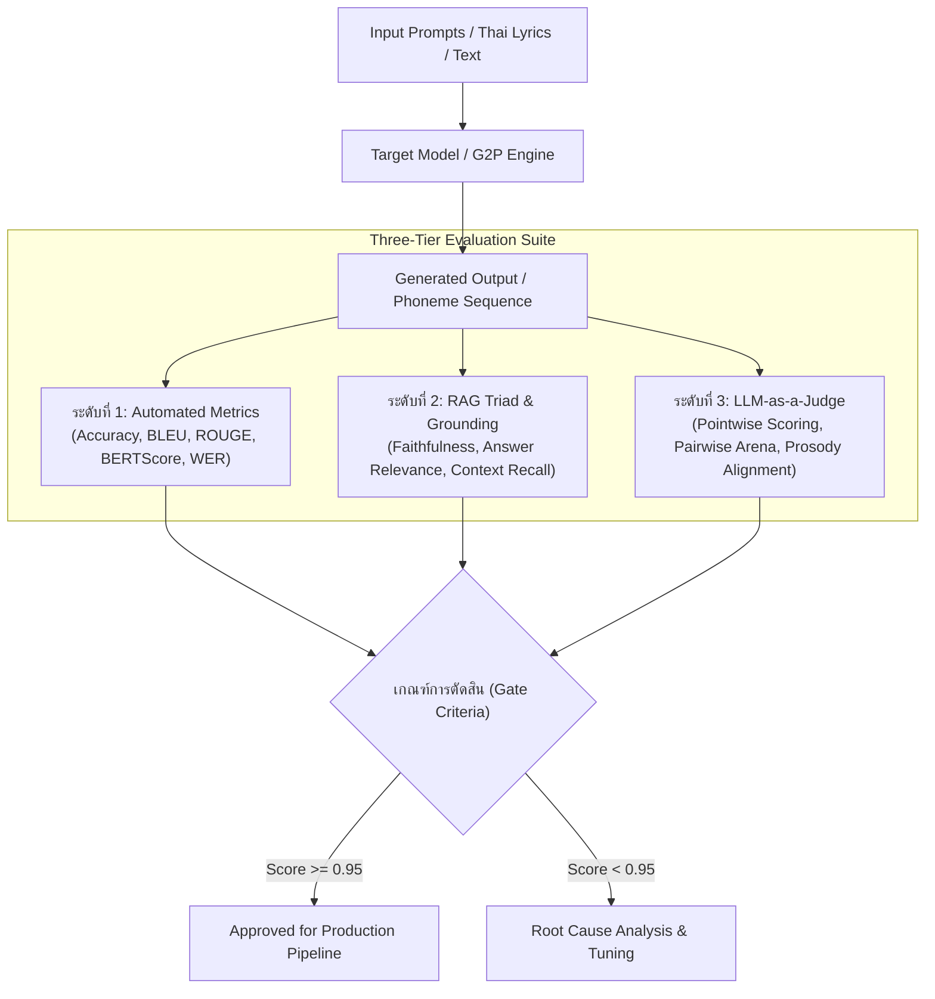

<!-- ======================================================================== -->
<!-- Date: 27/10/2569 (BE) / 27/10/2026 (CE)                               -->
<!-- File: DELTA_SYNTH_LLM_EVALUATION_FRAMEWORK.md                          -->
<!-- Version: 1.0.0                                                         -->
<!-- Made And Checked By DELTA SYNTH & All Code Agentic AI Engine           -->
<!-- [ Original by DELTA SYNTH ]                                            -->
<!-- Location: Docs/DELTA_SYNTH_LLM_EVALUATION_FRAMEWORK.md                 -->
<!-- Description: Master Enterprise Framework for LLM & G2P Evaluation      -->
<!--              (Automated Metrics, RAG Triad, LLM-as-a-Judge, Audio AI)  -->
<!-- ======================================================================== -->

# กรอบการประเมินผลปัญญาประดิษฐ์และโมเดลภาษา (LLM Evaluation Framework)
## DELTA SYNTH AI Benchmarking, RAG Triad & Evaluation Protocol

> **สถานะเอกสาร:** มาตรฐานหลักระดับองค์กร (DELTA SYNTH Master Engineering Specification)  
> **หลักการสำคัญ:** **Preserve → Strengthen → Optimize → Verify**  
> **เป้าหมาย:** สถาปัตยกรรมการวัดผล ประเมินคุณภาพ และตรวจสอบความถูกต้องของระบบ LLM, G2P (Grapheme-to-Phoneme), และโมเดลสังเคราะห์เสียง มุ่งสู่ **Zero Known Defects**

---

## 1. ขอบเขตและมิติการประเมินผล (Core Evaluation Dimensions)

* **TH:** การนำโมเดลภาษา (LLM) และระบบแปลงตัวหนังสือเป็นเสียงอ่าน (G2P Engine) มาใช้ในระบบของ DELTA SYNTH ต้องผ่านการทดสอบแบบหลายมิติ ครอบคลุมทั้งความแม่นยำของไวยากรณ์ ความซื่อตรงต่อบริบท และความลื่นไหลของการออกเสียง
* **EN:** Deploying LLMs and phonetic reasoning systems across DELTA SYNTH platforms requires rigorous multi-dimensional evaluation covering factual grounding, phonetic transcription accuracy, context retention, and latency efficiency.



---

## 2. เครื่องชี้วัดและการคำนวณอัตโนมัติ (Automated Metrics Engine)

ระบบประเมินผลประกอบด้วย 4 กลุ่มตัวชี้วัดหลัก:

### 2.1 สัทวิทยาและถอดรหัสคำอ่านภาษาไทย (Thai Phonetic & G2P Metrics)
- **Phoneme Error Rate (PER):** อัตราความคลาดเคลื่อนของหน่วยเสียงพยัญชนะ สระ และวรรณยุกต์ ต้องไม่เกิน **1.0%**
- **Syllable Boundary Accuracy (SBA):** ความถูกต้องในการตัดพยางค์คำควบกล้ำและสระประสม ต้องมากกว่า **99.5%**
- **Word Error Rate (WER):** อัตราความผิดพลาดในการถอดรหัสคำในพจนานุกรม

### 2.2 การสร้างข้อความและบทกวี (Text & Lyric Generation)
- **BLEU-4 / ROUGE-L:** วัดความคล้ายคลึงของโครงสร้างประโยคและคำร้อง
- **BERTScore:** วัดความหมายเชิงความหมาย (Semantic Similarity) ผ่าน Embeddings
- **Perplexity (PPL):** ความราบรื่นและเป็นธรรมชาติของภาษา

### 2.3 เสาหลัก RAG Triad (สำหรับระบบค้นหาเอกสารและพจนานุกรม)
1. **Faithfulness (ความซื่อตรง):** ตรวจสอบว่าคำตอบอ้างอิงจาก Context ในพจนานุกรมจริง ไม่มีการกุข้อมูลขึ้นเอง (Zero Hallucination)
2. **Answer Relevance (ความตรงประเด็น):** คำตอบตอบโจทย์ที่ผู้ใช้ถามอย่างกระชับ
3. **Context Recall (ความครอบคลุม):** ข้อมูลที่ดึงมาจากฐานข้อมูลครอบคลุมข้อเท็จจริงที่จำเป็นครบถ้วน

---

## 3. สถาปัตยกรรมตัวตรวจวัด LLM-as-a-Judge

สำหรับการประเมินความไพเราะของคำร้อง สัมผัสอักษร และการเน้นเสียงสูงต่ำ (Prosody):

```python
# scripts/delta_llm_judge.py
"""
DELTA SYNTH LLM-as-a-Judge Evaluation Script
Evaluates Thai lyric meter, prosodic rhythm, and phonetic coherence.
"""

from dataclasses import dataclass
from typing import List, Dict

@dataclass
class EvaluationRecord:
    prompt: str
    expected_phonemes: str
    generated_phonemes: str
    context: str

def calculate_phoneme_error_rate(reference: List[str], hypothesis: List[str]) -> float:
    # Levenshtein distance on phoneme sequence
    d = [[0] * (len(hypothesis) + 1) for _ in range(len(reference) + 1)]
    for i in range(len(reference) + 1):
        d[i][0] = i
    for j in range(len(hypothesis) + 1):
        d[0][j] = j
        
    for i in range(1, len(reference) + 1):
        for j in range(1, len(hypothesis) + 1):
            if reference[i-1] == hypothesis[j-1]:
                d[i][j] = d[i-1][j-1]
            else:
                d[i][j] = min(d[i-1][j] + 1,      # deletion
                              d[i][j-1] + 1,      # insertion
                              d[i-1][j-1] + 1)    # substitution
    return d[len(reference)][len(hypothesis)] / max(1, len(reference))

def evaluate_g2p_batch(test_cases: List[EvaluationRecord]) -> Dict[str, float]:
    per_scores = []
    for test in test_cases:
        ref_tokens = test.expected_phonemes.split()
        hyp_tokens = test.generated_phonemes.split()
        per = calculate_phoneme_error_rate(ref_tokens, hyp_tokens)
        per_scores.append(per)
        
    mean_per = sum(per_scores) / len(per_scores) if per_scores else 0.0
    accuracy = 1.0 - mean_per
    return {
        "mean_per": mean_per,
        "accuracy": accuracy,
        "zero_defect": mean_per == 0.0
    }
```

---

## 4. มาตรฐานการทดสอบก่อนส่งมอบ (Continuous Evaluation in CI)

1. **ห้ามบายพาสการประเมิน:** ทุกการอัปเดตโมเดลหรือพจนานุกรม ต้องผ่านชุดทดสอบ Regression Suite
2. **เกณฑ์ขั้นต่ำ:**
   - Thai G2P Accuracy $\ge 99.0\%$
   - RAG Groundedness $\ge 0.95$
   - Synthesizer Benchmark: 0 Memory Leaks, Latency $\le 15\text{ms}$
3. **การรายงานผล:** ผลการประเมินต้องถูกบันทึกเป็นตาราง JSONL และ Markdown สรุปผลเสมอ
