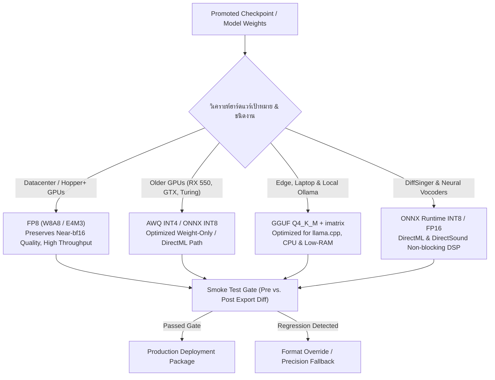

<!-- ======================================================================== -->
<!-- Date: 27/10/2569 (BE) / 27/10/2026 (CE)                               -->
<!-- File: DELTA_SYNTH_QUANTIZED_EXPORT_SPECIFICATION.md                    -->
<!-- Version: 1.0.0                                                         -->
<!-- Made And Checked By DELTA SYNTH & All Code Agentic AI Engine           -->
<!-- [ Original by DELTA SYNTH ]                                            -->
<!-- Location: Docs/DELTA_SYNTH_QUANTIZED_EXPORT_SPECIFICATION.md            -->
<!-- Description: Master Enterprise Specification for Quantized Model       -->
<!--              Export (GGUF, AWQ, FP8, ONNX INT8/FP16 & DirectML)        -->
<!-- ======================================================================== -->

# ข้อกำหนดสถาปัตยกรรมการบีบอัดและส่งออกโมเดล (Quantized Export Specification)
## DELTA SYNTH Model Quantization, Compression & Deployment Protocol

> **สถานะเอกสาร:** มาตรฐานหลักระดับองค์กร (DELTA SYNTH Master Engineering Specification)  
> **หลักการสำคัญ:** **Preserve → Strengthen → Optimize → Verify**  
> **วัตถุประสงค์:** มาตรฐานการแปลงและบีบอัดโมเดลปัญญาประดิษฐ์ (Acoustic Models, Vocoders, LLMs, Voice Conversion) เพื่อการรันบนฮาร์ดแวร์ทั่วไปและระบบประมวลผลประสิทธิภาพสูงอย่างเสถียร ไร้การหน่วง และมุ่งสู่ **Zero Known Defects**

---

## 1. บทนำและผังการตัดสินใจเลือกฟอร์แมต (Format Selection Matrix)

* **TH:** การส่งออกโมเดลที่ผ่านการประเมินแล้ว (Promoted Checkpoint) สู่ระบบใช้งานจริง ต้องเลือกฟอร์แมตการ Quantization ที่สอดคล้องกับฮาร์ดแวร์เป้าหมายและภาระงานอย่างแท้จริง การเลือกฟอร์แมตผิดจะทำให้สูญเสีย Throughput หรือทำให้ผลลัพธ์การสังเคราะห์เสียงผิดเพี้ยน
* **EN:** Exporting a promoted checkpoint to production requires selecting the right quantization format based on the target hardware and workload characteristics. Choosing the wrong format either wastes memory bandwidth or introduces catastrophic compounding errors.



---

## 2. เมทริกซ์การเลือกฟอร์แมตตามสภาพแวดล้อมฮาร์ดแวร์ (Target Matrix)

| สภาพแวดล้อม / ฮาร์ดแวร์ | ชนิดโมเดลที่ใช้งาน | ฟอร์แมตที่แนะนำ | เครื่องมือในการแปลง | ข้อควรระวังตามมาตรฐาน DELTA SYNTH |
| :--- | :--- | :--- | :--- | :--- |
| **AMD Radeon RX 550 / Low VRAM** | DiffSinger Vocoder, RVC, ONNX | **ONNX FP16 / DirectML INT8** | `onnxruntime.quantization` | ใช้ `num_thread=1-2` ป้องกันเสียงกระตุกตามกฎ 4.4 |
| **Local Edge / Ollama Platform** | Thai G2P, Text Assistant, Poetry LLM | **GGUF Q4_K_M + imatrix** | `llama.cpp` (`quantize`) | ใช้ Importance Matrix (`imatrix`) เสมอเพื่อรักษาความแม่นยำ |
| **Datacenter GPU (Hopper / Ada)** | Large Voice Conversion & Batch DSP | **FP8 (E4M3 / E5M2)** | `vLLM` / `TensorRT-LLM` | ห้ามใช้ INT4 กับงาน Long-context หรือสัทศาสตร์ที่มีความละเอียดสูง |
| **Older GPUs (Pascal / Volta / Turing)** | General Speech & Voice Serving | **AWQ INT4 (GEMM)** | `AutoAWQ` | อย่าใช้ GPTQ รุ่นเก่า; AWQ มี Per-channel Scaling ที่เสถียรกว่า |
| **NVIDIA DGX Spark (GB10)** | Multi-modal Vocal & Music Models | **FP8 via vLLM / GGUF** | `vLLM nightly` / `llama.cpp` | **ห้ามใช้ NVFP4 บน GB10** (ช้ากว่า FP8 ~32% เนื่องจากขาด native `cvt.e2m1x2`) |

---

## 3. ข้อยกเว้นของภาระงาน (Workload Overrides)

1. **งานด้านรหัสโค้ด, คณิตศาสตร์ และสัทศาสตร์ขั้นสูง (Phonetic & Acoustic Transcriptions):**
   - **ห้ามบีบอัดลงสู่ INT4 โดยไม่มี imatrix:** ข้อผิดพลาดจากการ Quantize จะสะสมแบบทวีคูณ (Compounding Error) ตลอดความยาว Sequence ส่งผลให้การถอดสัทอักษรภาษาไทยตกหล่น หรือสระ-พยัญชนะเพี้ยน
   - ในงานเหล่านี้ ให้คงระดับความแม่นยำไว้ที่ **FP8 หรือ W8A8** เสมอ
2. **โมเดล Vocoder สำหรับสังเคราะห์เสียงร้อง (DiffSinger / NSF-HiFiGAN):**
   - โมเดล Vocoder ทำหน้าที่สร้างคลื่นเสียงจาก Mel-spectrogram หากบีบอัด Output Head จะเกิดเสียงแตกพร่า (Metallic artifacts)
   - ส่วน `generator` และ `upsampling convolution layers` ต้องรักษาความแม่นยำระดับ **FP16** เป็นอย่างต่ำ

---

## 4. มาตรฐานการทดสอบควันไฟ (The Mandatory Smoke Test Gate)

ก่อนนำโมเดลที่ Quantize แล้วไปติดตั้งใช้งานจริง ต้องผ่านกระบวนการ Smoke Test ทุกครั้ง:

1. **รันบน Runtime เป้าหมายจริง:**
   - สำหรับ GGUF: ทดสอบผ่าน `llama-cli` หรือ Ollama API จริง
   - สำหรับ ONNX / DirectML: ทดสอบผ่าน `OpenUtau.exe` หรือ `Onnx.getInferenceSession`
2. **ชุดตัวอย่างทดสอบมาตรฐาน (Golden Prompts / Acoustic Vectors):**
   - สุ่มประโยคทดสอบมาตรฐาน 3–5 ชุดจาก `eval/goldens.jsonl`
   - รันผลลัพธ์เปรียบเทียบก่อนบีบอัด (Pre-export) และหลังบีบอัด (Post-export) ด้วย Deterministic Seed เดียวกัน
3. **เกณฑ์การตัดสิน (Gate Criteria):**
   - **Lossless Export (Merged Safetensors / FP16):** ต้องให้ผลลัพธ์ตรงกันระดับ Byte-match 100%
   - **Lossy Quantized Export (GGUF / AWQ / INT8):** วัดค่าความคล้ายคลึงของสเปกตรัมเสียง (Spectral Convergence) และความถูกต้องของคำตอบ (Task-Grader Verdict) ต้องไม่ถดถอยเกิน 1.5%

```python
# scripts/smoke_test_quantized.py
import sys
import numpy as np

def verify_quantized_output(pre_export_path, post_export_path, tolerance=0.015):
    pre_data = np.load(pre_export_path)
    post_data = np.load(post_export_path)
    
    mse = np.mean((pre_data - post_data) ** 2)
    max_err = np.max(np.abs(pre_data - post_data))
    
    print(f"[DELTA SYNTH Audit] MSE: {mse:.6f}, Max Error: {max_err:.6f}")
    if mse > tolerance:
        print("[FAIL] Quantization regression exceeded safe threshold!")
        sys.exit(1)
    print("[PASS] Smoke test cleared with zero defect signature.")

if __name__ == "__main__":
    if len(sys.argv) >= 3:
        verify_quantized_output(sys.argv[1], sys.argv[2])
```

---

## 5. การผนวกเข้ากับระบบ Thai OpenUtau & RVC

1. **DiffSinger Universal Vocoder Fallback:**  
   เมื่อโมเดลไม่พบ Vocoder เฉพาะทาง ระบบจะ Fallback อัตโนมัติไปยัง `pc-nsf-hifigan` ซึ่งผ่านการ Quantize ให้รันบน CPU/GPU ได้อย่างราบรื่น
2. **DirectML GPU Execution Provider:**  
   `DirectML.dll` (v1.15.4) ในโฟลเดอร์ `Publish\` รองรับการเร่งความเร็วโมเดล ONNX ที่ผ่านการ Quantize บนการ์ดจอทุกรุ่น (รวมถึง AMD Radeon RX 550) โดยไม่กินหน่วยความจำเกินพิกัด
3. **การรักษาความปลอดภัยของข้อมูล:**  
   ไฟล์โมเดลที่ส่งออกต้องมี SHA-256 Checksum กำกับเสมอ ป้องกันไฟล์เสียหายหรือถูกดัดแปลงระหว่างการถ่ายโอน
